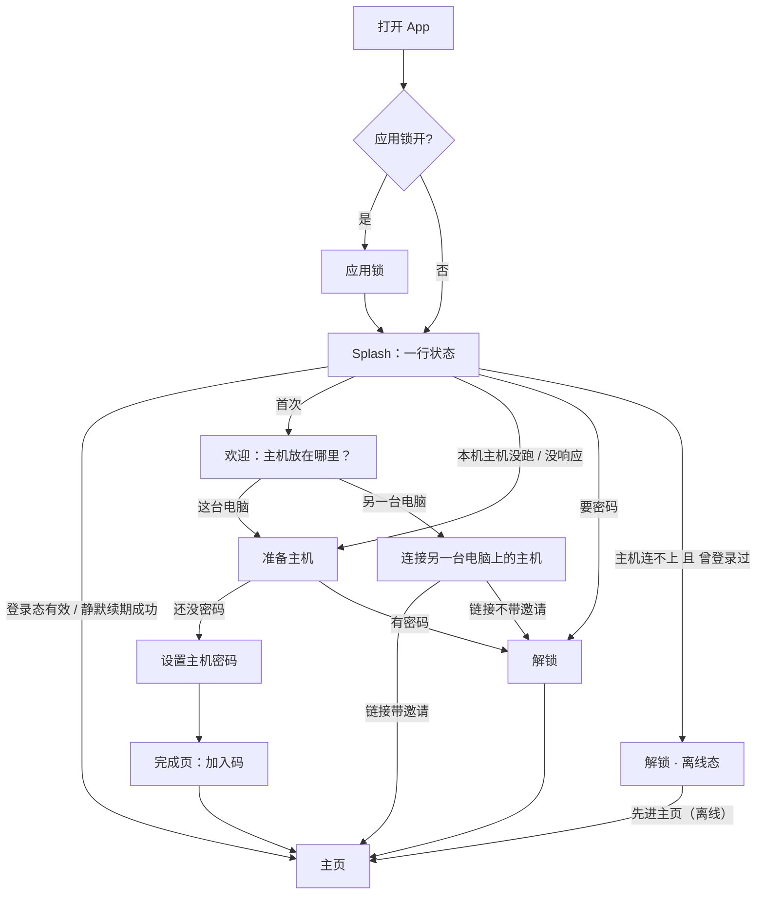
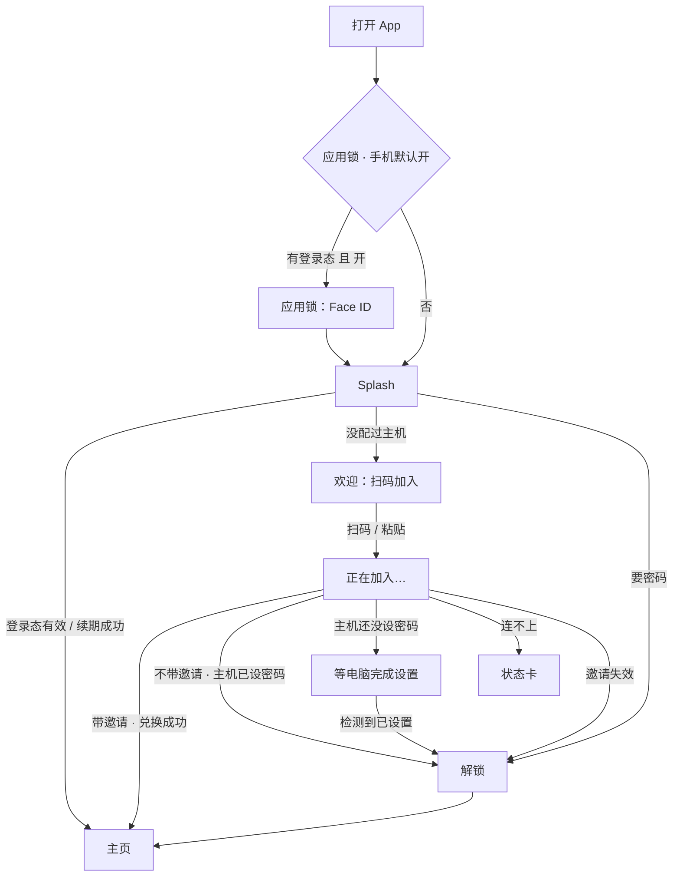
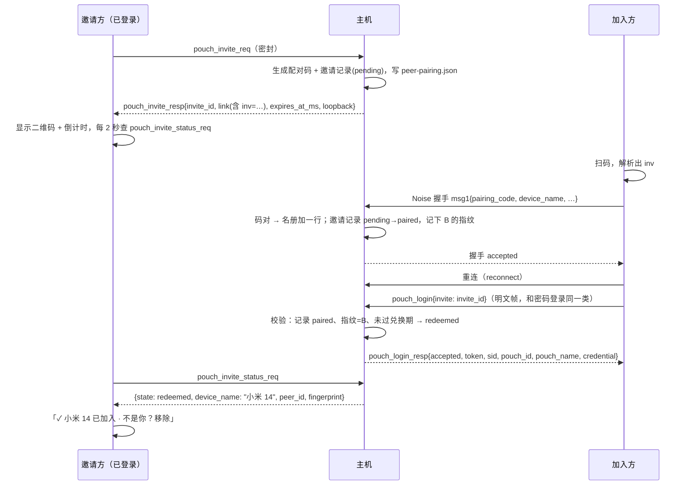

# 登录交互重设计：桌面端 + 移动端（决策记录）

- 日期：2026-10-31
- 状态：**已定稿，待实现**
- 涉及仓库：`shepaw`（Flutter App，主要）、`shepaw-cli`（Rust Hub，扫码即登录协议 + 两处修补）
- 前置文档：`docs/onboarding_host_flow_decision.md`（主机放哪儿、通讯录、引擎）。本文**只管「从打开 App 到进主页」这一段**，以及「让另一台设备加入」。那份文档的角色划分、`resolveHostEntry` 决策表、`host_mode` 存储都保留，本文在它上面加规则，不推翻。

本文写给编码 agent。读法：

- 第 1 节：现状和证据。**改之前先复现**，确认问题还在。
- 第 2 节：已拍板的决定。**不要再讨论或改动**，有疑问先问人。
- 第 3–6 节：要做成的样子（概念、桌面、手机、扫码即登录协议）。
- 第 7 节：共享组件、状态、错误、文案。
- 第 8 节：按 PR 列出的改动、测试和验收。
- 第 9 节：容易走偏的地方。**动手前必读**。

---

## 0. 一页摘要

| 场景 | 现在 | 改完 |
|---|---|---|
| 桌面新用户 | 第一屏直接是「创建储物袋 · 这台电脑会成为主机」，主机被悄悄拉起来 | 欢迎页先选主机放哪 → 自动准备主机 → 设一次密码 → 完成页直接显示给手机扫的码 |
| 手机新用户 | 电脑开终端敲 `shepaw pair`，复制链接 → 手机粘贴 → 输袋子名和密码 | 扫电脑上的码 → 直接进主页，**不输密码** |
| 回访（3 天以上没开） | 必须重输主机密码 | 用设备凭据静默续期，零交互（凭据 30 天） |
| 手机打开 App | 无保护 | 默认 Face ID / 指纹 / 设备密码解锁 |
| 主机连不上 | 卡在登录页 | 可以「先进主页（离线）」，连上后自动续期 |
| 出错 | 显示 `StateError: …` 原文 | 人话 + 出路；锁定有倒计时 |

---

## 1. 现状和根因

### 1.1 现在的门页

`lib/services/route_gate.dart` 里一共 9 个具名门页：

| 路由 | 页面 | 谁会到 | 备注 |
|---|---|---|---|
| `/` | `SplashScreen`（`lib/main.dart` 内） | 所有人 | 固定 `Future.delayed(1s)` |
| `/setup` | `PasswordSetupScreen` | **没人** | 旧本机密码，死路由 |
| `/login` | `LoginScreen` | **没人** | 旧本机密码 + 生物识别，死路由 |
| `/host-setup` | `HostSetupScreen` | 桌面，仅 `resolveBinary()` 为空时 | 选主机位置 |
| `/pouch-init` | `PouchGateScreen(initializing: true)` | 桌面 | 建袋子 + 设密码（两个密码框） |
| `/pouch-unlock` | `PouchGateScreen(initializing: false)` | 桌面 | 选袋子单选 + 输密码 |
| `/pouch` | `PouchLoginScreen`（650 行） | 桌面远端 / 切换 / 主机无响应 | 选主机 + 选袋子 + 弹窗输密码 |
| `/remote-connect` | `RemoteConnectScreen` → `PeerConnectTab` | 手机首次 | 扫码 / 粘贴 |
| `/phone-login` | `PhoneAuthScreen`（522 行） | 手机 | 三套标题、三套文案 |

另有 `RemoteHostGuideScreen`，桌面用 `MaterialPageRoute` 推出来，不在路由表里。

### 1.2 问题和证据

| # | 问题 | 证据 | 用户看到的 |
|---|---|---|---|
| P1 | **桌面启动绕过了入口决策。** Splash 只在登录态有效时调 `HostEntryNavigator.go`；过期或没有登录态时，直接按 `CliPouch.passwordIsSet` 去 `/pouch-init` 或 `/pouch-unlock`，不看 `host_mode`。启动时 `CliBundle.sync()` 总会把自带 CLI 拷进安装目录，所以 `resolveBinary()` 几乎不会为空，`/host-setup` 那条分支基本走不到。`passwordIsSet` 抛错时还会盲跳 `/pouch-unlock`。 | `lib/main.dart` `_SplashScreenState._checkPasswordStatus`；`main.dart` 启动处 `CliBundle.sync()` | 新用户看不到「主机放哪儿」，第一屏就是建袋子；提交时 `CliPouch._ensureHub` 会拉起主机，违反「没选过就不自动启动」。`host_mode = remote` 的用户登录过期后，会被带进**本机**的袋子页 |
| P2 | **每 3 天要重输一次密码。** 主机登录 TTL 3 天，设备凭据 30 天；但冷启动从不拿凭据静默续期。凭据只在 `PouchLoginKeeper` 收到 `pouch_login_required` 时才会用到。 | `shepaw-cli/crates/api/src/login.rs` `TTL_MS`；`lib/storage/pouch_login_keeper.dart` `_relogin` | 三天没开 App 就要输密码 |
| P3 | **一台主机只有一只袋子，界面还在让人选。** 主机拒绝建第二只；`PhonePouchMemory` 也只记一只。界面上却有袋子单选、「储物袋名称」输入框、「同名多只」报错。 | `login.rs` `create_pouch_account`（「这台主机已经有储物袋了，只能改名」）；`shepaw account rename` 的帮助文字；`phone_pouch_memory.dart` `decode` 只取最后一只 | 多一步无意义的选择；手机没缓存时要用户手打袋子名 |
| P4 | **文案在讲实现。** | `app_zh.arb`：`pouch_intro`（「业务帧用这次登录的密钥加密」）、`pouchGate_initBody`（「储物袋 ID 才是身份」）、`pouch_startCli`（「启动 shepaw」）、`peerConnect_pasteTitle`（「粘贴链接或 Hub 地址」）、`peerConnect_guideTitle`（「对方电脑还没有 Shepaw Hub？」） | 读不懂；Hub 地址那条路已经废了 |
| P5 | **手机第一次连主机，要么开终端，要么去「添加设备」深处找码。** 本机主机在跑时，桌面「添加设备 → 它连我」显示的已经是主机链接（`CliHost.mintShareLink`）；但首次流程里不出现这个码。桌面主机在**别的电脑**上时，这里会退回 `PeerPairingService.startPairing`，显示的是 App 自己的码，手机扫了登不上主机。 | `lib/peer/screens/peer_qr_display_screen.dart` `_startPairing` / `_showHubLink`；`lib/services/cli_host.dart` `mintShareLink` | 新手不知道码在哪；远端模式下的码是错的 |
| P6 | **配对之后还要再输一次密码。** 配对和登录是两件事：配对码只换来设备名册里的一行，登录还得走 `pouch_login` + 密码。 | `shepaw-cli/crates/peer/src/handshake.rs` `decide`；`login.rs` `issue` | 扫完码还要问家里人密码 |
| P7 | **错误直接吐原文。** 多处是 `setState(() => _error = '$error')`。主机返回的 `retry_after_ms` 没人读，锁定时没有倒计时。 | `pouch_gate_screen.dart` `_submit`；`phone_auth_screen.dart` `_submit` / `_prepare`；`login.rs`（`"试错太多次，请稍后再试"` + `retry_after_ms`） | 看到 `StateError: …`；锁定后不知道要等多久 |
| P8 | **等待没有反馈，或者反馈错位。** 桌面自动启动主机时弹不可关闭的 `AlertDialog`，最少挂 2 秒；失败时什么也不说，直接跳回 `/host-setup`。手机「我已经创建好了」要用户自己点，不会自动轮询。远端主机离线弹窗里的「重试」，失败时 `pop(false)`，弹窗消失，没有任何提示。 | `lib/onboarding/host_entry_flow.dart` `_autoLocal`；`phone_auth_screen.dart`；`lib/onboarding/remote_host_guide.dart` `_askOffline` | 卡住、闪回、点了没反应 |
| P9 | **密码框缺基本功能。** 没有显示/隐藏，没有大写锁定提示；6 位校验只在提交时报；桌面解锁页没有「忘记密码」。 | `pouch_gate_screen.dart` | 输错了才知道规则；忘了密码没有出路 |
| P10 | **视觉断层。** Splash 是品牌渐变大图标，之后每一页都是 `AppBar + ListView` 表单，在桌面宽窗口上铺满整屏。 | 各门页的 `build` | 像跳进了设置页 |
| P11 | **App 里移除设备不吊销凭据。** `pouch_peer_remove_req` 只删设备名册，没调 `pouch_credentials::revoke_fingerprint`，内存里的登录会话也没清；只有命令行 `shepaw peer remove` 会吊销。扫码即登录上线后，「移除」必须真的把人踢掉。 | `shepaw-cli/crates/api/src/pouch.rs` `peer_remove_at`；对照 `crates/cli/src/main.rs` 中调用 `revoke_fingerprint` 的地方 | 移除后，那台设备 30 天内仍能用凭据登录 |

---

## 2. 已拍板的决定

| # | 决定 | 含义 |
|---|---|---|
| D1 | **扫码即登录** | 已登录设备展示的「加入码」，本身就带一次性登录邀请。新设备扫码 → 配对 → 直接登录，**不输密码**。新设备加入后，展示方会看到「已加入 · 不是你？移除」。见第 6 节 |
| D2 | **首次设密码只用一个框** | 不要「再输一次」，改为可以显示/隐藏密码 |
| D3 | **主机连不上时可以离线进主页** | 曾经登录过的设备，在 Splash 或解锁页可以「先进主页（离线）」，连上后自动续期 |
| D4 | **应用锁默认值：手机开，桌面关** | 手机打开 App 时默认要求 Face ID / 指纹 / 设备密码；桌面默认不要求，可以在设置里开 |
| D5 | **用户只需要懂「主机」和「主机密码」** | 一台主机一只袋子。袋子只在欢迎语里露个名字，不让选、不让手打，不提 ID |
| D6 | **静默续期** | 登录态过期但设备凭据有效时，自动换新登录态，不打扰用户 |

---

## 3. 概念、路由和入口决策

### 3.1 用户可见的概念

| 用户看到的词 | 实际是什么 | 出现在哪 |
|---|---|---|
| 主机 | 跑着 `shepaw` Hub 的那台电脑 | 欢迎页、解锁页状态胶囊、设置 |
| 主机密码 | `pouch-password.json` 里的口令 | 首次设置、解锁页 |
| 加入码 | 带登录邀请的配对二维码 / 链接 | 完成页、设置 → 主机 → 添加设备、通讯录 |
| 「Eden 的储物袋」 | 这台主机唯一那只袋子的显示名 | 只出现在欢迎语和设置里 |

**禁止出现在门页上的词**：储物袋 ID、指纹、Hub、CLI、shepaw（命令行提示的代码块除外）、端口、业务帧、配对码（改叫「加入码」）。

### 3.2 新路由

| 新路由 | 页面（新文件） | 取代 | 平台 |
|---|---|---|---|
| `/` | `SplashScreen`（重写，挪到 `lib/onboarding/splash_screen.dart`） | 原 Splash | 两端 |
| `/welcome` | `WelcomeScreen` | `/host-setup`、`/remote-connect`、`RemoteHostGuideScreen` | 两端，布局不同 |
| `/host-install` | `HostInstallScreen` | `HostSetupScreen` 的安装部分、`_autoLocal` 的弹窗 | 桌面 |
| `/create-password` | `CreatePasswordScreen` | `/pouch-init` | 桌面 |
| `/unlock` | `UnlockScreen` | `/pouch-unlock`、`/phone-login`、`/pouch` 的登录部分 | 两端 |
| `/hosts` | `HostSwitcherScreen` | `/pouch` 的主机选择部分 | 两端，只在用户主动切换时出现 |
| `/app-locked` | `AppLockScreen` | 无（新增） | 两端，应用锁开启时 |

迁移规则：

- 每个 PR 只删它取代的那几个旧页面。旧路由名在 `MaterialApp.onGenerateRoute` 里做**别名转发**，保留到 PR-L6 一并删除。
- `route_gate.dart` 的 `loginGateRoutes` 同步加上新路由。`/app-locked` 也要算门页：锁屏上不能显示审核条，也不能让深链推进聊天。
- 所有 `pushNamedAndRemoveUntil('/pouch' | '/phone-login' | '/remote-connect' …)` 的调用点都要改。动手前先跑：
  ```
  rg "'/(pouch|phone-login|remote-connect|pouch-init|pouch-unlock|host-setup|setup|login)'" lib
  ```
  已知调用点有：`main.dart`、`host_entry_flow.dart`、`host_entry.dart` 的 `logoutRoute`、`pouch_login_keeper.dart` 的 `openChooser`、`settings_model.dart` 的切换袋子和退出登录、`remote_connect_screen.dart`、`phone_auth_screen.dart`、`pouch_gate_screen.dart`、`remote_host_guide.dart`。

### 3.3 统一入口决策 `resolveGate`

新文件 `lib/onboarding/gate_entry.dart`。这是**纯函数**，不读文件、不发请求，所有输入由调用方准备好。

```dart
enum UnlockReason { expired, credentialRejected, hostRestarted, inviteInvalid, switched }
enum HostInstallReason { firstInstall, notRunning, unresponsive }

sealed class GateEntry {
  const GateEntry({this.recordMode});
  final HostMode? recordMode;          // 非空时调用方写回 host_mode（沿用 HostEntry 的约定）
}
class GoHome extends GateEntry { const GoHome({super.recordMode}); }
class TryRestore extends GateEntry {   // 有凭据，先静默续期（4.1）；失败后由调用方再按 fallback 走
  const TryRestore({required this.hostPeerId, required this.fallback, super.recordMode});
  final String hostPeerId;
  final GateEntry fallback;
}
class GoWelcome extends GateEntry { const GoWelcome({super.recordMode}); }
class GoHostInstall extends GateEntry {
  const GoHostInstall({required this.reason, super.recordMode});
  final HostInstallReason reason;
}
class GoCreatePassword extends GateEntry { const GoCreatePassword({super.recordMode}); }
class GoUnlock extends GateEntry {
  const GoUnlock({required this.hostPeerId, this.reason = UnlockReason.expired, super.recordMode});
  final String hostPeerId;
  final UnlockReason reason;
}

GateEntry resolveGate({
  required bool isDesktop,
  required HostMode mode,
  required LocalCliStatus cli,            // 手机传 notInstalled
  required bool? localPasswordSet,        // 只有桌面本机才有意义；探测失败为 null；没探测为 null
  required PouchSession? session,
  required bool credentialValid,          // 有 session.hostPeerId + session.pouchId 对应、且未过期的凭据
  required String? rememberedHostId,      // 手机：PhoneHostStore；桌面：session?.hostPeerId
  required int nowMs,
  String? localCliFingerprint,
  String? sessionHostFingerprint,
});
```

判定顺序：自上而下，命中即返回。

| # | 平台 | 条件 | 结果 |
|---|---|---|---|
| 1 | 两端 | 登录态有效，且（桌面本机模式时）会话主机指纹 = 本机 CLI 指纹 | `GoHome`（桌面本机仍要先 `CliHost.attach`，沿用 `_enterHome`） |
| 2 | 手机 | 没有 `rememberedHostId` | `GoWelcome` |
| 3 | 手机 | 有主机，`credentialValid` | `TryRestore(fallback: GoUnlock(expired))` |
| 4 | 手机 | 有主机 | `GoUnlock(expired)` |
| 5 | 桌面 | `mode == unset`，CLI `running` | `recordMode = thisComputer`，然后按 9–12 行处理（老用户无感升级，沿用现状） |
| 6 | 桌面 | `mode == unset`，CLI 不在跑，有会话且主机不是本机 | `recordMode = remote`，然后按 7–8 行处理 |
| 7 | 桌面 | `mode == remote`，`credentialValid` | `TryRestore(fallback: GoUnlock(expired))` |
| 8 | 桌面 | `mode == remote` | 有 `rememberedHostId` → `GoUnlock`；否则 `GoWelcome` |
| 9 | 桌面 | `mode == unset`（其余情况） | `GoWelcome`（**修 P1**） |
| 10 | 桌面 | `thisComputer`，CLI 不在 `running` | `GoHostInstall(notInstalled ? firstInstall : notRunning)` |
| 11 | 桌面 | `thisComputer`，`running`，`localPasswordSet == null` | `GoHostInstall(unresponsive)`（**不再盲跳解锁页**） |
| 12 | 桌面 | `thisComputer`，`running`，`localPasswordSet == false` | `GoCreatePassword` |
| 13 | 桌面 | `thisComputer`，`running`，`credentialValid` | `TryRestore(fallback: GoUnlock(expired))` |
| 14 | 桌面 | `thisComputer`，`running` | `GoUnlock(hostPeerId: 本机主机那行)` |

说明：

- 第 10 行的 `GoHostInstall` 页面会在主机就绪后**自己重新调用 `resolveGate`**，自然落到 11–14 行。
- 第 14 行要用到本机主机那一行的 peer id：先 `CliHost.ensurePaired(cli)`，再拿它的 id。这一步放在调用方 `GateNavigator`（3.4）里做，`resolveGate` 只回 `GoUnlock(hostPeerId: '')`，表示「本机主机」，由调用方补上真实 id。
- 原 `resolveHostEntry` 和 `HostEntry` 系列保留到 PR-L6，届时删除；它们的测试迁移到 `test/onboarding/gate_entry_test.dart`。

### 3.4 `GateNavigator`

新文件 `lib/onboarding/gate_navigator.dart`，取代 `HostEntryNavigator`：

```dart
class GateNavigator {
  /// 收集输入 → resolveGate → 执行。所有「进门」都走这里：
  /// Splash、退出登录、keeper 要密码、切换主机后、HostInstall 完成后、应用锁解开后。
  static Future<void> go(BuildContext context, {GateHint? hint});
}
```

- `hint` 用来带上下文，比如 `GateHint.hostRestarted`：keeper 打开解锁页时，`GoUnlock.reason` 用它覆盖默认值。
- 执行 `TryRestore` 时调用 `CredentialRestore.run`（4.1）：
  - 结果是 `restored` → 进 `/home`；
  - 结果是 `rejected` → `GoUnlock(reason: credentialRejected)`；
  - 结果是 `unreachable` → `GoUnlock(expired)`，并把 `offline: true` 带给解锁页；
  - 结果是 `none` → 走 `fallback`。
- 输入收集的超时：`CliHost.probe` 3 秒，`CliPouch.passwordIsSet` 3 秒（超时记 `null`）。

---

## 4. 桌面端

### 4.0 流程



首次本机：点「用这台电脑」→ 自动准备 → 输一次密码 → 完成。**点 2 次，输 1 次。**

### 4.1 Splash 和静默续期

```
┌──────────────────────────────────────┐
│              [ 图标 ]                 │
│               惜宝                    │
│        正在连接 EDENZOU-MB2…          │  ← 一行状态，按阶段变化
│                                      │
│        跳过，先进主页（离线）           │  ← 条件出现，见下
└──────────────────────────────────────┘
```

- **去掉固定的 1 秒延迟**，改成「最少显示 300ms」，防止闪一下。
- 状态行的取值：`gate_splashStarting` → `gate_splashConnecting(host)` → `gate_splashRestoring`。
- 「跳过，先进主页（离线）」：同时满足以下三条才出现。
  1. 已经等了 1.5 秒；
  2. 本机有过登录（`PouchSessionStore.readActive()` 非空，过没过期都算）；
  3. 当前在连主机或续期。

  点它就进 `/home`，并标记 `OfflineEntry.active = true`（7.5）。

**`CredentialRestore`**：新文件 `lib/onboarding/credential_restore.dart`。

```dart
enum RestoreResult { restored, rejected, unreachable, none }

class CredentialRestore {
  CredentialRestore({
    required this.readSession,        // PouchSessionStore.readActive
    required this.readCredential,     // PouchCredentialStore.readValid（新增，见 8.1）
    required this.connect,            // (PairedPeer) → Future<void>；桌面本机用 CliHost.attach
    required this.login,              // requestPouchLogin
    required this.persist,            // 存会话
    required this.install,            // PouchChannel.install
    required this.saveCredential,
    required this.dropCredential,
  });

  /// 总预算 7 秒：连接 4 秒 + 登录 3 秒。连接超时直接返回 unreachable，不再登录。
  Future<RestoreResult> run({required String hostPeerId, Duration budget = const Duration(seconds: 7)});
}
```

- 连接这一步要沿用 `PhoneAuthScreen._probe` 的经验：息屏回来常常是半开连接。第一次超时后，`disconnectPeer` 再 `connectToPeer(ignoreTieBreak: true)` 重试一次，**两次共用同一份预算**。
- 主机回 `credential_rejected` → 删凭据 → `rejected`。
- 成功时，如果响应里带了新凭据（凭据登录一般不轮换），就存下来。
- 成功后调用 `PouchLoginKeeper.instance.clearPasswordRequired()`。
- `PouchLoginKeeper._relogin` 改用这个类（或抽出来的共享函数），**不要写两份续期逻辑**。

### 4.2 欢迎：主机放在哪里？（`/welcome`，桌面）

```
┌───────────────────────────────────────────────────────────┐
│  [图标]  欢迎使用惜宝                                        │
│          你的数据、惜宝和智能体都放在「主机」上。              │
│          主机需要一直开着，先选一台。                          │
│                                                             │
│  ┌─────────────────────────┐  ┌─────────────────────────┐ │
│  │ 🖥 这台电脑       推荐    │  │ 🔗 另一台电脑            │ │
│  │ 适合常开的台式机，或者   │  │ 主机已经装在家里或       │ │
│  │ 不常合盖的笔记本         │  │ 公司的电脑上             │ │
│  │ [   用这台电脑   ]       │  │ [   去连接   ]           │ │
│  └─────────────────────────┘  └─────────────────────────┘ │
│                                                             │
│  以后可以在「设置 → 主机」里更换                             │
└───────────────────────────────────────────────────────────┘
```

- 窗口宽度 ≥ 720 时两张卡片并排，窄时上下排。内容最大宽 640，居中。
- 「用这台电脑」：写入 `host_mode = thisComputer` → `/host-install`（`reason: firstInstall`）。
- 「去连接」：写入 `host_mode = remote`，在同一路由内切换到 4.6 的视图（不 push 新路由，系统返回键回到选择视图）。
- 键盘：`←` / `→` 切换卡片焦点，`Enter` 触发，默认焦点在推荐卡。

### 4.3 准备主机（`/host-install`）

路由参数是 `HostInstallReason`。三种进入原因共用一套步骤，已经满足的步骤直接打勾：

```
┌───────────────────────────────────────────┐
│  正在准备这台电脑上的主机                     │
│  ✓ 安装主机程序             应用自带 v0.9.3   │
│  ◐ 启动主机                 3 秒…            │
│  ○ 连接主机                                  │
│  ─────────────────────────────────────────  │
│  不想放在这台电脑？连接另一台电脑上的主机       │
└───────────────────────────────────────────┘
```

| 步骤 | 做什么 | 上限 | 失败时 |
|---|---|---|---|
| 安装 | `CliBundle.sync()`，然后 `CliHost.resolveBinary()`。没有自带包时：复制安装命令（`cliInstallCommand()`）+「我装好了」按钮，点了重跑本步骤。真正的下载安装归 `onboarding_host_flow_decision.md` 的 PR5，本文不做 | — | 标题「没能把主机程序放进这台电脑」· [复制安装命令] [我装好了] |
| 启动 | `CliHost.start(binary)`；它内部轮询 `detect`，最多 10 秒 | 15 秒 | 标题「主机没有启动起来」，折叠区显示日志末尾 20 行（读 `~/.config/shepaw-hub/logs/hub.log`，路径以 `CliHost` 现有常量为准）· [重试] [打开日志] |
| 连接 | `CliHost.attach(cli)` | 8 秒（`attach` 内部已有） | 标题「主机启动了，但没有响应」· [重启主机]（`shepaw restart`）[打开日志] |

- 全部完成后调用 `GateNavigator.go(context)`，自然落到 `GoCreatePassword`、`TryRestore` 或 `GoUnlock`。
- **回访时不先进这页**：`reason == notRunning` 时，Splash 先原地启动，状态行显示「正在启动主机…」；2 秒内成功就根本不进这页。超过 2 秒或失败才 `pushReplacement` 到这页，并从当前步骤接着显示。实现方式：`HostInstallController` 是一个 `ChangeNotifier`，Splash 先 new 一个开始跑，超时就把同一个 controller 作为路由参数交给 `HostInstallScreen`。
- 失败时停在失败的那一步，「重试」从那一步继续。
- **删除 `_autoLocal` 里的 `AlertDialog`**（修 P8）。

### 4.4 设置主机密码（`/create-password`）

```
┌───────────────────────────────────────────┐
│  设置主机密码                                 │
│  别的设备第一次连这台主机时，可以扫码加入，     │
│  也可以输这个密码。这台电脑会记住登录。         │
│                                             │
│  称呼                                        │
│  [ Eden                                  ]  │  ← 预填 LocalUserIdentity.displayName
│  会显示为「Eden 的储物袋」                     │
│                                             │
│  主机密码                                     │
│  [ ••••••••                           👁 ]  │
│  至少 6 位                        ⇪ 大写已开启 │
│                                             │
│  [            完成设置            ]          │
└───────────────────────────────────────────┘
```

- **只有一个密码框**（D2），用 `PasswordField`（7.1），默认隐藏，带 👁 切换。
- 「称呼」预填 `LocalUserIdentity.displayName`，为空时留空并显示占位「例如：Eden」。袋子名取 `l10n.pouch_namedBag(称呼)`；称呼为空时用 `pouch_defaultName`。
- 校验：
  - 称呼：可以为空；
  - 密码：少于 6 位时按钮仍可点，但下方「至少 6 位」变成错误色，并且不提交。
  - 主机侧上限：名字 64 字符（`checked_pouch_name`），前端用 `maxLength: 32` 截断称呼即可。
- 提交：`CliPouch.init(binary, name, password, fingerprint)` → `CliPouch.openLocal(grant)` → `/setup-done`（4.4.1，不进门页列表，因为此时已登录）。
- 失败映射见 7.3。主机回「这台主机已经初始化过了」时，说明别处刚设过密码：直接 `GateNavigator.go`，会落到解锁页。

#### 4.4.1 完成页（`/setup-done`，只在首次出现）

```
┌───────────────────────────────────────────┐
│  ✓ 准备好了                                  │
│  要在手机上也用惜宝吗？                        │
│  ┌───────────┐  1. 手机上安装并打开惜宝        │
│  │  [加入码]  │  2. 点「扫码加入」             │
│  │           │  3. 扫这个码，直接进入          │
│  └───────────┘  4:52 后失效 · 换一个           │
│                                             │
│  [     进入惜宝     ]     以后再说             │
└───────────────────────────────────────────┘
```

- 中间是 `JoinCodeCard`（7.1，协议见第 6 节）。
- 有设备加入后，卡片切成「✓ 小米 14 已加入 · 不是你？移除」，主按钮文案不变。
- 「进入惜宝」和「以后再说」都进 `/home`。离开页面时，如果邀请还没被用掉，`JoinCodeCard` 发 `pouch_invite_cancel_req`。

### 4.5 解锁（`/unlock`，两端共用）

路由参数：`UnlockArgs { String hostPeerId; UnlockReason reason; bool offline; }`

```
┌───────────────────────────────────────────┐
│                 [ 头像 ]                     │
│             欢迎回来，Eden                   │
│     主机 EDENZOU-MB2 · 这台电脑   ● 在线       │  ← HostStatusPill
│  ┌───────────────────────────────────────┐  │
│  │ 主机重启了，输入密码后会接着刚才的对话     │  │  ← 原因条，按 reason 决定是否出现
│  └───────────────────────────────────────┘  │
│  [ 主机密码                          👁 ]   │  ← autofocus
│  [              进入              ]          │
│  [ 👆 使用 Touch ID ]                        │  ← 「用生物识别解锁」开着时才出现
│        忘记密码？      ·      换一台主机        │
│        先进主页（离线）                        │  ← 离线且曾登录过时才出现
└───────────────────────────────────────────┘
```

**袋子不出现在界面上**（D5）。`GateController` 按以下顺序推出唯一的那只袋子：

1. `PouchSessionStore.readActive()`，且 `hostPeerId` 相同；
2. `PhonePouchMemory.read(hostId)`；
3. `PouchLoginMemory.read()`；
4. 主机的 `requestPouchList`（取第一只）；
5. 主机返回空列表：显示 7.3 的「主机上还没有储物袋」。

提交时如果还没推出来，就先同步请求一次 `requestPouchList`。

「欢迎回来，{name}」里的 `name` 取袋子名去掉「的储物袋」后缀；取不到就显示「欢迎回来」。

**原因条**，按 `reason` 决定：

| reason | 显示 |
|---|---|
| `expired` | 不显示（最常见，不打扰） |
| `credentialRejected` | 「主机密码改过，或这台设备被移除过，请重新输入」 |
| `hostRestarted` | 「主机重启了，输入密码后会接着刚才的对话」 |
| `inviteInvalid` | 「加入码已失效，请输入主机密码，或在已登录的设备上换一个加入码」 |
| `switched` | 不显示 |

**`HostStatusPill`**：显示「● 在线」/「◌ 连接中…」/「○ 连不上 · 重试」。

离线时：

- 密码框仍然可以输入。点「进入」时先连主机（4 秒），连不上就在胶囊下面展开说明：
  - 本机主机：「这台电脑上的主机没有响应」· [重启主机]
  - 远端主机：「连不上 EDENZOU-MB2。确认那台电脑开着、在同一网络，或者已经开启隧道」· [重试]
- **离线 → 在线时自动续期**：解锁页挂着时，监听 `PeerConnectionManager` 的连接变化。主机连上且 `credentialValid` 时，自动跑 `CredentialRestore`，成功就直接进主页，不用用户操作。

**锁定倒计时**（修 P7）：读 `retry_after_ms`。主按钮变成「29 秒后再试」并禁用；归零后自动恢复，并清掉错误文字。

**密码错误**：密码框抖动（7.6），清空内容，保持焦点，下面显示「密码不对」。

**「换一台主机」**：有两台以上主机时进 `/hosts`；只有一台时，桌面进 `/welcome` 的「去连接」视图，手机进 `/welcome`。

**快捷键**：`Enter` 提交；`Esc` 清空错误。

**提交成功后**：

1. 存会话（含 `hubUrl`，沿用 `PhoneAuthScreen._submit` 的取法：`localEndpoint` 优先，然后 `channelEndpoint`；桌面本机用 `cli.localEndpoint`）；
2. `PouchChannel.install`；
3. `PouchLoginKeeper.instance.clearPasswordRequired()`；
4. 手机额外 `PhoneHostStore.write`；
5. 写 `PouchLoginMemory` 和 `PhonePouchMemory`；
6. 首次在这台设备用密码登录成功、设备支持生物识别、开关还没设过时：进主页后弹一次 SnackBar「下次用 Touch ID 解锁？[开启]」（7.4）；
7. 进 `/home`。如果是 keeper 打断进来的（`reason == hostRestarted`），用 `pushNamedAndRemoveUntil('/home')`。原会话靠 keeper 现有的 `relogged` 事件恢复，**不用自己重放**。

### 4.6 连接另一台电脑上的主机（`/welcome` 的「去连接」视图，桌面）

```
┌───────────────────────────────────────────┐
│  ← 连接另一台电脑上的主机                       │
│  ① 在主机那台电脑上打开惜宝：                  │
│     设置 → 主机 → 添加设备，会出现加入码        │
│     那台电脑没装惜宝 App？在终端执行：          │
│     curl -fsSL …/install.sh | sh        [复制] │
│     shepaw start && shepaw pair         [复制] │
│  ② 把加入链接粘贴到这里                        │
│  [ shepaw://peer?…                       ]  │  ← 自动读剪贴板
│  已从剪贴板读取                               │
│  [            连接            ]              │
└───────────────────────────────────────────┘
```

- **自动读剪贴板**：视图出现时，以及窗口重新获得焦点时（`AppLifecycleListener.onResume`），各读一次剪贴板。内容能被 `PeerPairingInfo.tryParse` 解析，就预填并显示「已从剪贴板读取」。
- 输入实时校验：解析失败时，输入框下方显示「这不是有效的加入链接」，按钮禁用。
- 点「连接」后，按钮变成「正在连接…」，输入框禁用，旁边出现「取消」。
- 结果：
  - 链接带邀请（`inv` 参数）：走 6.4 的兑换。成功进 `/home`；失败进 `/unlock(reason: inviteInvalid)`。
  - 链接不带邀请：`/unlock`。
  - 配对成功但主机连不上：**不弹窗**，原地显示 `GateStatusCard`：
    ```
    已记下 EDENZOU-MB2，但现在连不上
    确认那台电脑开着、在同一网络，或者已经开启隧道
    [ 再试一次 ]   先进入（离线）
    ```
    「再试一次」在卡片里显示进度；失败时卡片抖一下，文案变成「还是连不上」，卡片不关。修 P8。
    「先进入（离线）」：没有登录态时进 `/unlock(offline: true)`，不进主页。

### 4.7 忘记密码

| 场景 | 方案 |
|---|---|
| 桌面，主机在本机 | 「忘记密码？」→ 对话框「在这台电脑上重设主机密码。其他设备当前的登录还能用到过期，之后要输新密码或者扫加入码。」→ `BiometricService.authenticate(reason: …)`，**必须** `biometricOnly: false`，允许系统账户密码兜底 → 新密码框（`PasswordField`）→ `CliPouch.setPassword(binary, password)`（新增，走 `shepaw password set`，密码从 stdin 传）→ 用新密码自动登录。系统认证失败或取消就停在对话框，不改密码 |
| 桌面远端 / 手机 | 对话框：「密码只能在主机那台电脑上重设。打开那台电脑上的惜宝，点『忘记密码』；或者在那台电脑的终端执行：」+ 代码块 `shepaw password set` [复制]。**另外提示**：「如果你有另一台已登录的设备，在它的 设置 → 主机 → 添加设备 里出示加入码，扫码就能进，不用密码。」 |

已核实：`shepaw password set` 不要旧密码，从 stdin 读一行新密码，并在 `set_pouch_password`（`crates/api/src/login.rs`）里调 `pouch_credentials::revoke_all` 吊销**所有**设备凭据。所以：

- CLI 不用改；
- 重设之后，这台电脑自己的凭据也失效了，必须紧接着用新密码登录一次，换一张新凭据（`CliPouch.login` → `openLocal`）；
- 其他设备当前的会话还能用到 token 过期（最长 3 天），之后续期会收到 `credential_rejected`，走解锁页（`reason: credentialRejected`）。

### 4.8 设置页改动

「设置 → 主机」一节：

- 新增「添加设备」，打开 `JoinCodeCard`（全屏页或侧栏面板，桌面放进 `desktop_home_screen` 现有的 `_RightPanelView.pairDevice` 位置）。
- `peer_qr_display_screen.dart` 的「它连我」页签：已登录时**统一改用 `JoinCodeCard`**，修 P5 的远端分支。没登录时（理论上门页之外到不了）保留现状。

「设置 → 隐私与安全」（没有这一节就新建）：

| 开关 | 键（SharedPreferences） | 默认 | 说明 |
|---|---|---|---|
| 打开惜宝时验证身份 | `app_lock_enabled` | 手机 `true`，桌面 `false`（D4） | 7.4 |
| 用 {Touch ID / Face ID / 指纹 / Windows Hello} 解锁主机 | `biometric_unlock_enabled` | 未设（首次密码登录后询问） | 凭据失效需要密码时，先尝试生物识别 → 用凭据续期；只有凭据也不行才要密码。**不存主机密码** |

---

## 5. 手机端

### 5.0 流程



首次：**扫码 → 进入**。回访：Face ID 一次（应用锁）。

### 5.1 Splash

同 4.1。手机没有本机主机，状态行是「正在连接 {host}…」。

### 5.2 欢迎（`/welcome`，手机）

```
┌───────────────────────────┐
│        [ 插画 ]            │
│   加入你的主机              │
│   惜宝的数据放在你的电脑上， │
│   扫电脑上的加入码就能用。   │
│  [ 📷  扫码加入 ]           │  ← 主按钮
│      粘贴加入链接            │  ← 文字按钮
│  ─────────────────────    │
│  加入码在哪？                │
│  电脑上打开惜宝：            │
│  设置 → 主机 → 添加设备      │
│  电脑还没装惜宝？            │
│  去 shepaw.com 下载 →       │
└───────────────────────────┘
```

- 扫码复用 `PeerScanScreen`，**只取扫到的字符串**，在这里解析，然后进 5.3。不要用它内部的配对逻辑（如果有的话），保证配对和兑换都在 `GateController` 里。动手前先读 `PeerScanScreen.show` 的返回值。如果它已经配好了对，就新增一个只返回原始字符串的入口（例如 `PeerScanScreen.scanRaw`）。
- 「粘贴加入链接」：打开底部弹层，进入时自动读剪贴板预填，实时校验。
- 相机权限被拒：扫码页内显示「需要相机权限才能扫码」· [去设置开启]（`openAppSettings()`，`permission_handler` 已有）· [改用粘贴]。
- 从解锁页「换一台主机」进来时，左上角有返回，回到 `/unlock`（沿用 `remoteConnectLoginHost` 的语义）。

### 5.3 正在加入（`/welcome` 内的过渡视图）

```
   [ 电脑 ] ⇄ [ 手机 ]          ← 脉冲动画
   正在加入 EDENZOU-MB2…
   [ 取消 ]
```

步骤共用 15 秒预算：

1. 配对：`PeerPairingService.instance.requestPairing(info)`。手机未登录时 `PouchPairing.runsOnThisDevice` 为真，本来就在本机握手。
2. 连接：`connectToPeer(peer, ignoreTieBreak: true)`。
3. 分支：
   - `info.inviteId != null`：调 `GateController.redeemInvite`（6.4）。成功 → `PhoneHostStore.write` → `/home`，并弹 SnackBar「已加入 Eden 的储物袋」。邀请无效 → `/unlock(reason: inviteInvalid)`。
   - 没有邀请：`requestPouchPasswordStatus`。已设 → `/unlock`；未设 → 5.4。
   - 连不上：原地显示 `GateStatusCard`。手机上不提供「先进入（离线）」，因为还没登录过，主页上没有可看的东西。
4. 「取消」：中止后面的步骤。已经配上的设备行**保留**，下次可以直接进解锁页。

### 5.4 等电脑完成设置

```
   这台主机还没设置好
   在电脑上打开惜宝，按提示设置主机密码，
   设置好之后这里会自动继续。
   ◌ 正在等待…
   [ 现在检查 ]
```

- 每 3 秒查一次 `requestPouchPasswordStatus`，最长 10 分钟；查到已设置就自动跳 `/unlock`。修 P8。
- App 进后台时暂停轮询（`AppLifecycleListener`），回到前台立刻查一次。
- 10 分钟后停止轮询，文案换成「还在等吗？设置好后点下面的按钮」。

### 5.5 解锁（`/unlock`，手机）

和 4.5 是同一个 `UnlockScreen`，下面只列手机上的差异：

- 键盘弹起时，主按钮要始终在键盘上方。`GateScaffold` 负责：`resizeToAvoidBottomInset: true` + `SingleChildScrollView`，底部留出 `MediaQuery.viewInsets.bottom`。
- 密码框加 `autofillHints: [AutofillHints.password]`，外层包 `AutofillGroup`。提交成功后调 `TextInput.finishAutofillContext()`，让钥匙串或系统自动填充记住主机密码。再放一个隐藏的 username 字段，`autofillHints: [AutofillHints.username]`，值为 `主机名 (指纹前 8 位)`，避免多台主机的密码串号。
- 本机记得袋子时立即可输入，主机探测在后台跑（保留现有设计）。

### 5.6 应用锁（`/app-locked`）

```
┌───────────────────────────┐
│        [ 图标 ]            │
│        惜宝已锁定            │
│   [ 🙂 使用 Face ID 解锁 ]  │
└───────────────────────────┘
```

见 7.4。

---

## 6. 扫码即登录：协议

### 6.1 角色和流程

- **邀请方**：任何已登录的设备（桌面本机、桌面远端、手机都可以）。
- **加入方**：还没配对、或者已配对但没登录的设备。
- **主机**：签发邀请、绑定设备、兑换登录。



### 6.2 主机侧数据

**邀请记录文件**：`<hub_root>/peer-invites.json`，权限 0600，原子写（`shepaw_fs::atomic_write_private`，和 `peer-pairing.json` 同样的写法）。

```json
{
  "version": 1,
  "invites": [
    {
      "id": "b64url 16 字节随机",
      "code": "ABCD2345",
      "pouch_id": "…",
      "inviter_fingerprint": "…",
      "inviter_name": "EDENZOU-MB2",
      "created_at_ms": 0,
      "code_expires_at_ms": 0,
      "state": "pending | paired | redeemed | cancelled | expired",
      "peer_fingerprint": null,
      "peer_id": null,
      "device_name": null,
      "paired_at_ms": null,
      "redeem_before_ms": null,
      "redeemed_at_ms": null
    }
  ]
}
```

- `code_expires_at_ms` = 创建时间 + `PAIRING_TTL_MS`（5 分钟，沿用现有常量）。
- `redeem_before_ms` = `paired_at_ms` + 10 分钟。配对之后，加入方要在这段时间里完成兑换。
- 每次写入时清理：删掉创建超过 24 小时的记录；最多保留 50 条。
- 读写函数放在新文件 `crates/hub/src/invite_file.rs`，从 `crates/hub/src/lib.rs` 导出（`pairing_file.rs` 就是这么做的）。路径函数 `peer_invites_path()` 加在 `crates/hub/src/paths.rs`，紧挨着 `peer_pairing_path()`。

**配对文件**：`PairingFile` 增加一个字段：

```rust
#[serde(rename = "inviteId", default, skip_serializing_if = "Option::is_none")]
pub invite_id: Option<String>,
```

一台主机同一时间**只有一个有效配对码**（单槽，这是现有设计）。新邀请会顶掉旧码，包括终端 `shepaw pair` 打出来的码。被顶掉的邀请记录标为 `cancelled`。邀请方状态轮询拿到 `cancelled` 时，`JoinCodeCard` 显示「这个码已被新的码替代 · 换一个」。

### 6.3 帧定义

全部新帧都是**密封帧**：不进 `login_clear_allowed`，也不进 App 侧 `loginSealRequired` 的 `clear` 集合。两边默认就要求密封，**不用改名单**，但要写测试断言它们必须密封。

**`pouch_invite_req` → `pouch_invite_resp`**

```json
{"type":"pouch_invite_req","request_id":"…"}
```
```json
{
  "type":"pouch_invite_resp","request_id":"…","ok":true,
  "invite_id":"…","link":"shepaw://peer?local=…&code=…&name=…&inv=…#fp=…&pk=…",
  "code":"ABCD2345","expires_at_ms":0,"endpoint":"ws://192.168.1.5:18793/peer/ws",
  "name":"EDENZOU-MB2","loopback":false,"channel":false
}
```

- 链接的生成逻辑**从 `crates/cli/src/main.rs` 的 `fn pair` 里抽出来**，放到 hub crate 的新函数里：`pub fn mint_pairing(opts: MintOptions) -> Result<Minted, String>`。CLI 的 `shepaw pair` 和这个帧共用它，不能各写一份。地址选择沿用 `pairing_endpoint(service_status(...), host, port)` 和 channel 配置那段。
- `inv` 参数放在 query 部分，`name` 后面，`#` 前面。`build_peer_qr_payload` 增加 `invite_id: Option<&str>`；`parse_peer_qr` 增加 `invite_id: Option<String>`。老版本解析会忽略未知参数，**要加测试确认**。
- `loopback: true`（Hub 只监听回环地址）时仍然签发，但邀请方要显示警告（7.1 的 `JoinCodeCard`）。
- 失败：`ok:false, code:"error", message`。

**`pouch_invite_status_req` → `pouch_invite_status_resp`**

```json
{"type":"pouch_invite_status_req","request_id":"…","invite_id":"…"}
```
```json
{"type":"pouch_invite_status_resp","request_id":"…","ok":true,
 "state":"pending|paired|redeemed|cancelled|expired",
 "device_name":"小米 14","peer_id":"…","fingerprint":"…","expires_at_ms":0}
```

- `state` 在读取时实时算：`pending` 且已过 `code_expires_at_ms` → `expired`；`paired` 且已过 `redeem_before_ms` → `expired`。
- 找不到记录：回 `ok:true, state:"expired"`。不要用 `ok:false`，App 好处理。

**`pouch_invite_cancel_req` → `pouch_invite_cancel_resp`**

```json
{"type":"pouch_invite_cancel_req","request_id":"…","invite_id":"…"}
```

- 记录是 `pending` 时标为 `cancelled`。如果 `peer-pairing.json` 的 `inviteId` 等于它，就 `clear_pairing_file`。
- `paired` 或 `redeemed` 时什么都不做，回 `ok:true`（要撤销已经加入的设备，用 `pouch_peer_remove_req`）。

**`pouch_login` 增加 `invite` 字段**（明文帧，现有）：

```json
{"type":"pouch_login","request_id":"…","pouch_id":"","invite":"<invite_id>"}
```

### 6.4 主机侧逻辑

**握手**（`crates/peer/src/server.rs`，`HandshakeOutcome::PairingAccepted` 分支，紧挨着 `upsert_paired_peer` 之后）：

```rust
if let Some(invite_id) = active.as_ref().and_then(|entry| entry.invite_id.as_deref()) {
    // 失败只记日志，不影响配对本身
    shepaw_hub::mark_invite_paired_at(&invites_path, invite_id, &peer.fingerprint, &peer.id, &peer.device_name, now_ms);
}
```

- `ServerConfig` 增加 `invites_path: PathBuf`，和 `pairing_path` 一样由调用方传入。测试里的 `ServerConfig` 构造都要补这个字段（`server.rs` 里有 5 处 `on_peer_online: None` 的测试构造，一并补）。
- 只有记录是 `pending`、并且 `code` 和当前配对码相同时，才改成 `paired`。

**兑换**（`crates/api/src/login.rs`，`LoginBook::issue`）：

在 `match password_state(&hub)` **之前**插入：

```text
if let Some(invite_id) = request["invite"].as_str().filter(非空) {
    match password_state(&hub) {
        Missing | Corrupt => 按现有分支回（拒绝）
        Set | Unset => {}
    }
    记录 = 读 peer-invites.json 找 invite_id
    条件全部成立才放行：
      记录.state == paired
      记录.peer_fingerprint 与 peer.fingerprint 相同（忽略大小写）
      now <= 记录.redeem_before_ms
      self.pouch_known(记录.pouch_id)
    放行：
      记录.state = redeemed, redeemed_at_ms = now（先写文件，再签发）
      pouch_id = 记录.pouch_id（忽略请求里的 pouch_id）
      issue_new = true（要签发设备凭据）
      走现有的 grant → 回包；回包里额外加 "pouch_name"
    不放行：
      回 {accepted:false, password_required:true, code:"invite_invalid", reason:"加入码已失效"}
      不计入密码试错次数
}
```

- 兑换失败**不计入**密码试错次数（`Throttle`），也不消耗凭据。
- `pouch_name` 用现有 `self.pouches()` 里同一个 id 的名字。

**移除设备**（修 P11，`crates/api/src/pouch.rs` 的 `peer_remove_at`，以及 `lib.rs` 里调用它的地方）：

1. `remove_paired_peer`（现有）；
2. `pouch_credentials::revoke_fingerprint(&hub_root, &fingerprint)`；
3. `LoginBook` 新增 `pub fn drop_fingerprint(&mut self, fingerprint: &str) -> usize`，清掉这台设备的内存会话。`peer_remove` 要拿到 `logins`：`lib.rs` 的分发处有 `self` 上下文，`LoginBook` 是 `Arc<Mutex<_>>`，参照同文件里传 `logins` 的其他函数；
4. 如果这台设备在线，断开它的连接。先查 `self.live` 有没有断开的方法；没有就跳过这一步，记在 PR 描述里。下一帧会因为会话没了收到 `pouch_login_required`，凭据也被拒，效果一样。

**终端用户**（可选，P2）：`shepaw pair --invite`，在本机签发带邀请的码，`inviter_fingerprint` 记为 `"local-cli"`。能在主机上开终端的人本来就能 `shepaw password set`，信任级别一样。**本轮不做**，只在 C 系列里留个编号。

### 6.5 App 侧逻辑

**解析**（`lib/peer/models/pairing_payload.dart`）：

- `PeerPairingInfo` 增加 `final String? inviteId;`，`tryParse` 读 `uri.queryParameters['inv']`。
- `PeerPairingInfo.encode` 增加 `String? inviteId`，写在 `name` 之后。
- **`PouchPairTicket.encode` 也要透传 `inviteId`**（`lib/peer/pouch_pair.dart`），否则已登录设备转交给主机时会把邀请丢掉。不过已登录设备扫码，走的是「主机去配别人」，不需要兑换，这个参数只是为了保持数据完整，不要在转交路径上触发兑换。

**兑换**（`lib/storage/pouch_login_client.dart`）：

```dart
Future<PouchLoginGrant> requestPouchInviteLogin({
  required String hostPeerId,
  required String inviteId,
  Duration timeout = const Duration(seconds: 8),
});
```

- 发 `{type: pouch_login, pouch_id: '', invite: inviteId}`。
- `PouchLoginGrant` 增加 `pouchId` 和 `pouchName`（从回包读）。
- `code == 'invite_invalid'` 时抛 `PouchInviteInvalid`。
- 成功时和密码登录一样保存凭据（`credentials.save`，现有逻辑）。

**邀请方**（`lib/peer/pouch_invite.dart`，新文件）：

```dart
class PouchInvite {
  final String id; final String link; final DateTime expiresAt; final bool loopback; final String hostName;
}
enum PouchInviteState { pending, paired, redeemed, cancelled, expired }
class PouchInviteStatus { final PouchInviteState state; final String? deviceName; final String? peerId; final String? fingerprint; }

class PouchInviteClient {
  Future<PouchInvite> create({required String hostPeerId});
  Future<PouchInviteStatus> status({required String hostPeerId, required String inviteId});
  Future<void> cancel({required String hostPeerId, required String inviteId});
}
```

- 发送走现有的「请求-响应」通道，参照 `PouchPairRelay._send`，包括它对 `pouch_login_required` 的处理（`retryOnRelogin`）。超时 8 秒。
- 帧类型加进 `PouchPair.controlTypes` 或同类的白名单。先 `rg controlTypes` 看路由是怎么分发响应的，**不要另起一套分发**。

**老版本兼容**：

| 组合 | 结果 |
|---|---|
| 新 App 扫老主机的码（没有 `inv`） | 走密码 |
| 老 App 扫新主机的邀请码 | 忽略 `inv`，配对成功后要密码。邀请记录停在 `paired`，10 分钟后过期，无害 |
| 新 App 向老主机发 `pouch_invite_req` | 老主机回 `pouch_login_required`，或者不认识这个帧、超时。App 显示「主机版本太旧，暂不支持加入码」，并给出 `shepaw update` 命令。邀请方要能区分：8 秒超时视为不支持 |
| 新 App 向老主机发 `pouch_login{invite}` | 老主机忽略 `invite`，回「需要主机密码」→ App 进 `/unlock(reason: inviteInvalid)` |

### 6.6 安全边界（实现时逐条对照）

| 威胁 | 缓解 |
|---|---|
| 加入码被偷拍或截图 | 5 分钟过期；一次性（配对成功即清空配对文件）；兑换要和配对时的设备指纹一致；邀请方看到「已加入 · 不是你？移除」，移除即吊销凭据并清会话（P11） |
| 暴力猜配对码 | 现有：错 10 次（`PAIRING_FAILURE_LIMIT`）作废，外加按 IP 限流 |
| 只拿到 `invite_id` 就想兑换 | 兑换校验 `peer_fingerprint`，只有用这个码配对的那台设备能兑换 |
| 没登录的人签发邀请 | `pouch_invite_req` 必须是密封帧，必须有有效会话 |
| 邀请被兑换两次 | 状态机只允许 `paired → redeemed` 一次。先写文件，再签发 |
| 邀请方离开页面后码还活着 | `JoinCodeCard.dispose` 时发 cancel；即使没发出去，5 分钟后也会过期 |
| 主机日志泄密 | 日志只打 `invite_id` 前 6 位和设备指纹，**不打** `code`、`link`、`credential` |

---

## 7. 共享部分

### 7.1 组件（`lib/onboarding/widgets/`）

| 组件 | 要点 |
|---|---|
| `GateScaffold` | 所有门页的骨架。浅色品牌背景（`AppTheme` 里取，**不要新造颜色常量**）；内容最大宽度 440，桌面上居中成卡片，手机全宽；顶部图标区、标题、副标题；底部次要操作区；`SafeArea`；键盘避让 |
| `PasswordField` | 👁 显示/隐藏；桌面大写锁定提示（`HardwareKeyboard.instance.lockModesEnabled.contains(KeyboardLockMode.capsLock)`，监听按键刷新）；`autofillHints`；`minLength` 提示行；`errorText`；`shake()` 方法（7.6） |
| `HostStatusPill` | 入参是 `hostPeerId`；监听 `PeerConnectionManager.instance` 的连接状态；文字 + 颜色点；离线时带「重试」回调 |
| `GateStatusCard` | 图标、标题、说明、主按钮、次按钮，加一个可折叠的「详情」（原始错误，`SelectableText`）。带 `shake()` |
| `StepList` | 每一步四种状态：待做 / 进行中（显示已用秒数）/ 完成（右侧可带附注，如版本号）/ 失败（展开错误和出路按钮） |
| `JoinCodeCard` | 入参是 `hostPeerId`。进入时调 `PouchInviteClient.create`；显示二维码（项目已有的二维码组件，`rg QrImageView` 找）、链接[复制]、倒计时；每 2 秒查一次状态；`redeemed` 时显示「✓ {device} 已加入 · 不是你？移除」，「移除」调 `PouchPairRelay.instance.remove(hostPeerId: …, fingerprint: status.fingerprint)`（按指纹删，不是 peer id）；`cancelled` 或 `expired` 时显示「换一个」；`loopback == true` 时在码上面盖一层提示「主机现在只允许这台电脑连接，手机连不上」，本机主机给[重启主机]按钮（`shepaw restart`；如果 `hub.json` 的 `peer.host` 是回环地址，要先确认 restart 能不能改回 `0.0.0.0`，不能就改为提示命令 `shepaw start --host 0.0.0.0`），远端主机只显示提示；`dispose` 时，如果状态还是 `pending`，就发 cancel |

### 7.2 门页状态

`lib/onboarding/gate_controller.dart`，继承 `ChangeNotifier`（遵守 CLAUDE.md 的状态管理约定，不引入新框架）。

```dart
class GateController extends ChangeNotifier {
  GateController({required GateDeps deps});   // 依赖全部注入，方便测试

  String? hostPeerId;
  HostReachability reach;            // unknown / connecting / online / offline
  PouchDescriptor? pouch;            // 推出来的唯一那只
  bool? passwordSet;
  GateError? error;                  // 已经映射好的错误（7.3）
  DateTime? lockedUntil;             // 来自 retry_after_ms
  bool busy;

  Future<void> load(String hostPeerId);                          // 推袋子 + 探测主机
  Future<bool> submitPassword(String password);                  // 解锁
  Future<bool> redeemInvite(PeerPairingInfo info);               // 6.5
  Future<bool> createPassword({required String nickname, required String password}); // 桌面首次
  Future<void> retryConnect();
}
```

搬家清单（**搬过来，不要重写**）：

| 来源 | 搬到 |
|---|---|
| `PhoneAuthScreen._probe`、`probeRetryable`、`_probeBudget` | `GateController` 的探测逻辑 |
| `PhoneAuthScreen._loadRemembered`、`choosePhonePouch`、`phonePouchesToShow` | `lib/onboarding/gate_pouch.dart`（纯函数） |
| `PhoneAuthScreen._submit` 的会话保存段 | `GateController._acceptGrant`（和 `CredentialRestore` 共用） |
| `PouchLoginScreen._enter` 的 `hubUrl` 取法 | `gate_pouch.dart` 的 `hubUrlFor(peer, cli)` |
| `PouchGateScreen._submit` 的 `CliPouch.init/login` 段 | `GateController.createPassword` 和桌面本机解锁 |

现有测试中引用了这些函数的（`rg "choosePhonePouch|phonePouchesToShow|pickPhonePouch|probeRetryable|defaultPouchAccount" test`），随函数一起迁移。已知有 `test/onboarding/phone_auth_test.dart`，删 `phone_auth_screen.dart` 时把它迁成 `gate_pouch_test.dart` / `gate_controller_test.dart`，**用例一个都不能丢**。

### 7.3 错误映射

新文件 `lib/onboarding/gate_errors.dart`：`GateError mapGateError(Object error)`。

先改 `lib/storage/pouch_login_client.dart`：登录失败时抛一个结构化异常。

```dart
class PouchLoginRejected implements Exception {
  final String reason; final String? code; final Duration? retryAfter;
  final bool passwordRequired; final bool credentialRejected;
}
```

`PouchPasswordRequired` 和 `PouchCredentialRejected` 改成它的子类，现有的 `on PouchPasswordRequired` 写法继续可用。

| 输入 | `GateError.kind` | 标题 | 出路 |
|---|---|---|---|
| `code == wrong_password`；没有 `code` 时：`reason` 含「密码不对」 | `wrongPassword` | 密码不对 | 忘记密码？ |
| `retryAfter != null` | `locked` | 试错太多次，{n} 秒后再试 | 倒计时 |
| `credentialRejected` | `credentialRejected` | （不当错误显示，转原因条） | — |
| `code == invite_invalid` / `PouchInviteInvalid` | `inviteInvalid` | 加入码已失效 | 输入密码 / 换一个码 |
| `reason` 含「没有这只袋子」 | `pouchMissing` | 主机上找不到你的储物袋，它可能被重建过 | 本机：[重新设置]；远端：[换一台主机] |
| `reason` 含「口令文件丢失」或「密码文件损坏」 | `passwordFileBroken` | 主机的密码文件坏了 | 本机：[重设密码]；远端：复制 `shepaw password set` |
| `reason` 含「已经初始化过了」 | `alreadyInitialized` | （不显示，直接 `GateNavigator.go`） | — |
| `TimeoutException`、连接失败 | `unreachable` | 主机状态胶囊变成离线 + 4.5 的说明 | 重试 / 重启主机 |
| `reason` 含「旧版本」，或者邀请请求 8 秒超时 | `hostOutdated` | 主机版本太旧，请在主机上执行 shepaw update | 复制命令 |
| 其他 | `unknown` | 没能登录，请稍后再试 | 重试 · 详情 |

**硬性规则**：

- `lib/onboarding/` 下任何地方都**不允许**把 `'$error'`、`error.toString()`、`error.message` 直接放进 `Text`。原始错误只进 `LoggerService` 和 `GateStatusCard` 的「详情」。
- 加一条测试 `test/onboarding/no_raw_error_text_test.dart`：读 `lib/onboarding/**/*.dart` 源码，用正则断言没有 `Text\(\s*'\$error'`、`Text\(\s*error\.`、`_error = '\$error'` 这类写法。

### 7.4 应用锁和生物识别

新文件 `lib/services/app_lock_service.dart`，在 `setupServiceLocator` 里注册：

```dart
class AppLockService extends ChangeNotifier {
  bool get enabled;                         // app_lock_enabled，缺省值见 4.8
  Future<void> setEnabled(bool value);      // 开启前先 authenticate 一次，失败就不开
  bool get locked;
  Future<bool> unlock();                    // BiometricService.authenticate(biometricOnly: false)
  void onPaused();                          // 记下进后台的时间
  void onResumed();                         // 后台超过 5 分钟 → locked = true
}
```

- **什么时候上锁**：冷启动，或者后台超过 5 分钟后回来。而且只在「本机有登录态」时上锁（`readActive() != null`）；还没登录过的门页本来就没东西可保护。
- **怎么上锁**：`navigatorKey` 推 `/app-locked`（门页）。解锁成功后 `pop`，回到原页面。冷启动时，先过应用锁，再进 Splash 的续期。
- **设备不支持**（没有设置任何锁屏方式，`isDeviceSupported() == false`）：视为关闭，不提示，不打扰。
- **认证被取消**：停在锁屏，按钮可以再点。不提供任何绕过方式。
- 平台：iOS / Android / macOS / Windows 走 `local_auth`；Linux 不支持，开关隐藏。
- iOS 要确认 `Info.plist` 有 `NSFaceIDUsageDescription`。先 `rg NSFaceIDUsageDescription ios`，没有就补。
- `BiometricService` 需要新增：
  - `methodLabel()` → `Face ID` / `Touch ID` / `指纹` / `Windows Hello` / `设备密码`（用 `getAvailableBiometrics()` 判断）；
  - `authenticate` 支持传 `biometricOnly`，看现有签名，缺就加。

**生物识别解锁主机**（`biometric_unlock_enabled`）：

- 解锁页出现、且开关打开时，自动拉起一次认证。认证通过后跑 `CredentialRestore`。凭据无效时提示「需要输入主机密码」，并聚焦密码框。
- 本质是「用生物识别保护设备凭据的使用」，**不存主机密码**。

### 7.5 离线进入

- `lib/onboarding/offline_entry.dart`：`ValueNotifier<bool> OfflineEntry.active`。
- 主页顶部离线条：和现有的 `PouchReloginBanner` 放在一起，文案「主机离线 · 连上后会自动登录」。
- `PouchLoginKeeper` 增加一个处理：主机连接状态变成在线、`OfflineEntry.active == true`、并且登录态无效时，跑 `CredentialRestore`。成功就把 `active` 置为 `false`，并触发 `relogged`；凭据无效就走现有的 `_passwordRequired` 提示条。
- **动手前先确认**：没有 `PouchChannel.active` 时，主页、会话列表、聊天页能不能正常打开，不崩溃、不无限转圈。列出不行的页面，在 PR 里修，或者给出离线占位。不要假设没问题。

### 7.6 视觉和动效

- 门页之间的转场：淡入 + 上移 8px，200ms。在 `onGenerateRoute` 里给门页用 `PageRouteBuilder`，其他页面保持不变。
- 密码错误：输入框水平抖动 3 次，共 300ms；手机加 `HapticFeedback.mediumImpact()`。
- 成功：主按钮里出现 ✓，停 250ms 再切页。
- 进行中的按钮：文字换成进行时（「正在进入…」），宽度不变。
- 无障碍：图标按钮都带 `tooltip`；状态胶囊除了颜色还有文字；倒计时包一层 `Semantics(liveRegion: true)`。

### 7.7 文案

加在 `lib/l10n/app_zh.arb`（模板文件）和 `app_en.arb`，然后 `flutter gen-l10n`。带参数的键要写 `@` 元数据。

| 键 | 中文 | English |
|---|---|---|
| `gate_splashStarting` | 正在启动… | Starting… |
| `gate_splashConnecting` | 正在连接 {host}… | Connecting to {host}… |
| `gate_splashRestoring` | 正在恢复登录… | Restoring your session… |
| `gate_splashStartingHost` | 正在启动主机… | Starting the host… |
| `gate_skipOffline` | 跳过，先进主页（离线） | Skip and continue offline |
| `welcome_title` | 欢迎使用惜宝 | Welcome to Shepaw |
| `welcome_desktopIntro` | 你的数据、惜宝和智能体都放在「主机」上。主机需要一直开着，先选一台。 | Your data, She and agents live on a host computer that stays on. Pick one first. |
| `welcome_thisComputer` | 这台电脑 | This computer |
| `welcome_thisComputerDesc` | 适合常开的台式机，或者不常合盖的笔记本 | Best for a desktop or a laptop that stays open |
| `welcome_useThisComputer` | 用这台电脑 | Use this computer |
| `welcome_recommended` | 推荐 | Recommended |
| `welcome_otherComputer` | 另一台电脑 | Another computer |
| `welcome_otherComputerDesc` | 主机已经装在家里或公司的电脑上 | The host already runs on a computer at home or work |
| `welcome_goConnect` | 去连接 | Connect |
| `welcome_changeLater` | 以后可以在「设置 → 主机」里更换 | You can change this later in Settings → Host |
| `welcome_phoneTitle` | 加入你的主机 | Join your host |
| `welcome_phoneIntro` | 惜宝的数据放在你的电脑上，扫电脑上的加入码就能用。 | Shepaw keeps your data on your computer. Scan its join code to start. |
| `welcome_scan` | 扫码加入 | Scan to join |
| `welcome_paste` | 粘贴加入链接 | Paste join link |
| `welcome_whereCode` | 加入码在哪？ | Where's the join code? |
| `welcome_whereCodeBody` | 电脑上打开惜宝：设置 → 主机 → 添加设备 | On your computer, open Shepaw: Settings → Host → Add device |
| `welcome_noDesktop` | 电脑还没装惜宝？去 shepaw.com 下载 | No Shepaw on your computer yet? Get it at shepaw.com |
| `connect_title` | 连接另一台电脑上的主机 | Connect to a host on another computer |
| `connect_step1` | 在主机那台电脑上打开惜宝：设置 → 主机 → 添加设备，会出现加入码 | On the host computer, open Shepaw: Settings → Host → Add device |
| `connect_step1Terminal` | 那台电脑没装惜宝 App？在终端执行： | No Shepaw app there? Run in a terminal: |
| `connect_step2` | 把加入链接粘贴到这里 | Paste the join link here |
| `connect_clipboardDetected` | 已从剪贴板读取 | Pasted from clipboard |
| `connect_invalidLink` | 这不是有效的加入链接 | That isn't a valid join link |
| `connect_button` | 连接 | Connect |
| `connect_connecting` | 正在加入 {host}… | Joining {host}… |
| `connect_savedButOffline` | 已记下 {host}，但现在连不上 | {host} is saved but unreachable right now |
| `connect_offlineHint` | 确认那台电脑开着、在同一网络，或者已经开启隧道 | Make sure it's on, on the same network, or has a tunnel enabled |
| `connect_tryAgain` | 再试一次 | Try again |
| `connect_stillOffline` | 还是连不上 | Still unreachable |
| `connect_enterOffline` | 先进入（离线） | Continue offline |
| `connect_joined` | 已加入 {pouch} | Joined {pouch} |
| `hostInstall_title` | 正在准备这台电脑上的主机 | Preparing the host on this computer |
| `hostInstall_stepInstall` | 安装主机程序 | Install host |
| `hostInstall_stepStart` | 启动主机 | Start host |
| `hostInstall_stepConnect` | 连接主机 | Connect to host |
| `hostInstall_bundled` | 应用自带 {version} | Bundled {version} |
| `hostInstall_installFailed` | 没能把主机程序放进这台电脑 | Couldn't install the host program |
| `hostInstall_copyCommand` | 复制安装命令 | Copy install command |
| `hostInstall_installedIt` | 我装好了 | I've installed it |
| `hostInstall_startFailed` | 主机没有启动起来 | The host didn't start |
| `hostInstall_unresponsive` | 主机启动了，但没有响应 | The host started but isn't responding |
| `hostInstall_restart` | 重启主机 | Restart host |
| `hostInstall_openLog` | 打开日志 | Open log |
| `hostInstall_useOther` | 不想放在这台电脑？连接另一台电脑上的主机 | Prefer another computer? Connect to its host |
| `createPassword_title` | 设置主机密码 | Set a host password |
| `createPassword_body` | 别的设备第一次连这台主机时，可以扫码加入，也可以输这个密码。这台电脑会记住登录。 | Other devices can join by scanning a code or entering this password. This computer stays signed in. |
| `createPassword_nickname` | 称呼 | Your name |
| `createPassword_nicknameHint` | 会显示为「{name}」 | Shown as "{name}" |
| `createPassword_submit` | 完成设置 | Finish |
| `password_label` | 主机密码 | Host password |
| `password_minLength` | 至少 6 位 | At least 6 characters |
| `password_capsLock` | 大写已开启 | Caps Lock is on |
| `password_show` / `password_hide` | 显示密码 / 隐藏密码 | Show password / Hide password |
| `done_title` | 准备好了 | All set |
| `done_phonePrompt` | 要在手机上也用惜宝吗？ | Use Shepaw on your phone too? |
| `done_phoneSteps` | 1. 手机上安装并打开惜宝\n2. 点「扫码加入」\n3. 扫这个码，直接进入 | 1. Install and open Shepaw on your phone\n2. Tap "Scan to join"\n3. Scan this code — you're in |
| `done_enter` | 进入惜宝 | Open Shepaw |
| `done_later` | 以后再说 | Later |
| `joinCode_title` | 添加设备 | Add a device |
| `joinCode_body` | 用另一台设备扫这个码，直接进入，不用输密码 | Scan this code on another device to sign in without a password |
| `joinCode_expiresIn` | {time} 后失效 | Expires in {time} |
| `joinCode_refresh` | 换一个 | New code |
| `joinCode_replaced` | 这个码已被新的码替代 | This code was replaced by a newer one |
| `joinCode_expired` | 加入码已过期 | This code has expired |
| `joinCode_joined` | {device} 已加入 | {device} joined |
| `joinCode_notYou` | 不是你？移除 | Not you? Remove |
| `joinCode_removed` | 已移除 {device} | Removed {device} |
| `joinCode_loopback` | 主机现在只允许这台电脑连接，其他设备连不上 | The host only accepts connections from this computer right now |
| `joinCode_unsupported` | 主机版本太旧，暂不支持加入码 | The host is too old for join codes |
| `joinCode_copyLink` | 复制链接 | Copy link |
| `unlock_welcomeBack` | 欢迎回来，{name} | Welcome back, {name} |
| `unlock_welcomeBackPlain` | 欢迎回来 | Welcome back |
| `unlock_hostLine` | 主机 {host} | Host {host} |
| `unlock_hostThisComputer` | 这台电脑 | This computer |
| `unlock_enter` | 进入 | Sign in |
| `unlock_entering` | 正在进入… | Signing in… |
| `unlock_whyCredential` | 主机密码改过，或这台设备被移除过，请重新输入 | The host password changed or this device was removed. Please sign in again |
| `unlock_whyRestarted` | 主机重启了，输入密码后会接着刚才的对话 | The host restarted. Sign in to pick up where you left off |
| `unlock_whyInvite` | 加入码已失效，请输入主机密码，或在已登录的设备上换一个加入码 | That join code expired. Enter the host password, or get a new code from a signed-in device |
| `unlock_lockedCountdown` | {seconds} 秒后再试 | Try again in {seconds}s |
| `unlock_wrongPassword` | 密码不对 | Wrong password |
| `unlock_tooManyAttempts` | 试错太多次 | Too many attempts |
| `unlock_forgot` | 忘记密码？ | Forgot password? |
| `unlock_switchHost` | 换一台主机 | Use another host |
| `unlock_useBiometric` | 使用 {method} | Use {method} |
| `unlock_offerBiometric` | 下次用 {method} 解锁？ | Use {method} next time? |
| `unlock_offerBiometricAction` | 开启 | Turn on |
| `unlock_needPassword` | 需要输入主机密码 | Host password needed |
| `hostStatus_online` | 在线 | Online |
| `hostStatus_connecting` | 连接中… | Connecting… |
| `hostStatus_offline` | 连不上 | Unreachable |
| `hostOffline_local` | 这台电脑上的主机没有响应 | The host on this computer isn't responding |
| `hostOffline_remote` | 连不上 {host}。确认那台电脑开着、在同一网络，或者已经开启隧道 | Can't reach {host}. Make sure it's on, on the same network, or has a tunnel |
| `hostOffline_banner` | 主机离线 · 连上后会自动登录 | Host offline · you'll be signed in when it's back |
| `waitHost_title` | 这台主机还没设置好 | This host isn't set up yet |
| `waitHost_body` | 在电脑上打开惜宝，按提示设置主机密码，设置好之后这里会自动继续。 | Open Shepaw on the computer and set a host password. We'll continue automatically. |
| `waitHost_checkNow` | 现在检查 | Check now |
| `waitHost_stale` | 还在等吗？设置好后点下面的按钮 | Still waiting? Tap below once it's set up |
| `forgot_localTitle` | 重设主机密码 | Reset host password |
| `forgot_localBody` | 在这台电脑上重设主机密码。其他设备当前的登录还能用到过期，之后要输新密码或者扫加入码。 | Reset the host password on this computer. Other devices stay signed in until their session expires, then need the new password or a join code. |
| `forgot_authReason` | 验证身份以重设主机密码 | Verify it's you to reset the host password |
| `forgot_remoteBody` | 密码只能在主机那台电脑上重设。打开那台电脑上的惜宝，点「忘记密码」；或者在那台电脑的终端执行： | The password can only be reset on the host. Open Shepaw there and choose "Forgot password", or run in its terminal: |
| `forgot_useJoinCode` | 如果你有另一台已登录的设备，在它的「设置 → 主机 → 添加设备」里出示加入码，扫码就能进，不用密码。 | Have another signed-in device? Show a join code from Settings → Host → Add device and scan it. |
| `appLock_title` | 惜宝已锁定 | Shepaw is locked |
| `appLock_unlock` | 使用 {method} 解锁 | Unlock with {method} |
| `appLock_reason` | 验证身份以打开惜宝 | Verify it's you to open Shepaw |
| `settings_privacy` | 隐私与安全 | Privacy & security |
| `settings_appLock` | 打开惜宝时验证身份 | Require verification to open Shepaw |
| `settings_biometricUnlock` | 用 {method} 解锁主机 | Unlock host with {method} |
| `settings_addDevice` | 添加设备 | Add device |
| `gate_errorGeneric` | 没能登录，请稍后再试 | Couldn't sign in. Please try again |
| `gate_errorPouchMissing` | 主机上找不到你的储物袋，它可能被重建过 | Your pouch isn't on this host. It may have been rebuilt |
| `gate_errorPasswordFile` | 主机的密码文件坏了 | The host's password file is broken |
| `gate_errorHostOutdated` | 主机版本太旧，请在主机上执行 shepaw update | The host is outdated. Run shepaw update on it |
| `gate_details` | 详情 | Details |
| `gate_retry` | 重试 | Retry |
| `gate_camera` | 需要相机权限才能扫码 | Camera access is needed to scan |
| `gate_cameraSettings` | 去设置开启 | Open Settings |
| `gate_usePaste` | 改用粘贴 | Paste instead |

PR-L6 统一删除的键（每删一个先 `rg` 确认没有其他引用）：

- `pouchGate_*`、`phoneAuth_*`、`hostSetup_*`、`remoteHost_*`；
- `pouch_intro`、`pouch_pouchSection`、`pouch_newName`、`pouch_startCli`、`pouch_redetect`、`pouch_pairFirst`、`pouch_pair`；
- `peerConnect_guideTitle`、`peerConnect_guideAction`；
- 只给旧 `LoginScreen` / `PasswordSetupScreen` 用的 `login_*` 和 `passwordSetup_*`。

`peerConnect_pasteTitle` / `peerConnect_pasteSubtitle` 改成不提「Hub 地址」的说法。

---

## 8. 改动清单（按 PR）

### 8.0 通用要求（每个 PR 都适用）

1. **开 worktree**：`cd /Users/edenzou/workspace/shepaw/shepaw`（改 Rust 时进 `shepaw-cli`），然后 `EnterWorktree`。见仓库根目录的 `AGENTS.md`。
2. **检查**：
   - App：`flutter analyze` + `flutter test --exclude-tags=needs-plugins`；
   - CLI：只测改到的 crate，例如 `cargo test -p shepaw-api --lib login::`、`cargo test -p shepaw-peer`、`cargo test -p shepaw-hub`。不要跑全量（见 `shepaw-cli/CLAUDE.md`）。
3. **先写纯函数和单测，再接 UI。** 依赖都通过构造参数注入，测试里不碰 SharedPreferences 和平台通道。要用就打 `@Tags(['needs-plugins'])`。
4. **不要引入新的状态管理框架。** 新的全局服务在 `service_locator.dart` 注册。
5. **门页不写死中文**，全部走 arb。`phone_auth_screen.dart` 里写死的「主机没有回应…」随迁移一起改掉。
6. 每个 PR 描述里，逐条贴上本节「验收」的实测结果。没测到的写「未测」和原因。

### PR-L1：入口决策 + 静默续期（App）

修 P1、P2。D6。

| 文件 | 改动 |
|---|---|
| `lib/onboarding/gate_entry.dart`（新） | 3.3：`GateEntry`、`UnlockReason`、`HostInstallReason`、`resolveGate` |
| `lib/onboarding/credential_restore.dart`（新） | 4.1：`CredentialRestore`、`RestoreResult` |
| `lib/storage/pouch_credential_store.dart` | 新增 `Future<PouchCredential?> readValid({required String hostPeerId, required String pouchId, required int nowMs})`，逻辑从 `PouchLoginKeeper._readCredential` 搬过来 |
| `lib/storage/pouch_login_keeper.dart` | `_readCredential` 改调 `readValid`；`_relogin` 的「凭据 → 失败删凭据 → 再试」主干改用 `CredentialRestore` 的共享函数 |
| `lib/onboarding/gate_navigator.dart`（新） | 3.4。本 PR 里新结果先映射到**旧路由**：`GoWelcome` → `/host-setup`（桌面）或 `/remote-connect`（手机）；`GoHostInstall` → 沿用 `_autoLocal`；`GoCreatePassword` → `/pouch-init`；`GoUnlock` → `/pouch-unlock`（桌面本机）、`/pouch`（桌面远端）、`/phone-login`（手机） |
| `lib/main.dart` `_SplashScreenState` | 整个 `_checkPasswordStatus` 换成「最少 300ms + `GateNavigator.go`」；状态行先固定显示 `gate_splashConnecting` |
| `lib/onboarding/host_entry_flow.dart` | `HostEntryNavigator.go` 内部改为转调 `GateNavigator.go`（保持调用点不变） |
| `lib/onboarding/host_entry.dart` | `logoutRoute` 暂不动（L6 再收） |

测试：

- `test/onboarding/gate_entry_test.dart`：3.3 表里的 14 行各一个用例；另加「`localPasswordSet == null` 不去解锁页」「手机有主机无凭据」两个边界。
- `test/onboarding/credential_restore_test.dart`：
  - `restored`；
  - `rejected`（并断言凭据被删）；
  - `unreachable`（连接超时，断言**没有**发登录）；
  - `none`（没有凭据）；
  - 第一次超时、第二次成功（断开重连）；
  - 总预算耗尽。
- 已有的 `test/onboarding/host_entry_test.dart` 继续通过（L6 删除 `resolveHostEntry` 时，把其中仍有意义的用例并入 `gate_entry_test.dart`）。

验收：

1. 清空 `host_mode`（SharedPreferences）、停掉 Hub、删 `pouch_session.json`，启动桌面 App：进的是选主机页，**不是**建袋子页；`shepaw status` 显示 Hub 没被拉起。
2. `host_mode = remote`，登录态过期：进远端主机的登录页，不是本机的。
3. 把 `pouch_session.json` 的 `expires_at` 改成过去时间，凭据有效：冷启动直接进主页，日志里有续期成功。
4. 在主机上执行 `shepaw password set` 改密码，再冷启动：进登录页，本机凭据已删除。
5. 主机关掉、凭据有效：7 秒内离开 Splash，进登录页。

### PR-L2：主机侧——加入码和移除修补（CLI）

修 P6 的主机部分、P11。D1。

| # | 文件 | 改动 |
|---|---|---|
| C1 | `crates/hub/src/pairing_file.rs` | `PairingFile` 加 `invite_id`（6.2），`serde(default)` 兼容旧文件 |
| C1 | `crates/hub/src/invite_file.rs`（新）+ `paths.rs` + `lib.rs` 导出 | 邀请记录的读、写、清理；`create_invite`、`mark_invite_paired_at`、`invite_state_at`、`redeem_invite_at`、`cancel_invite_at`；`peer_invites_path()` |
| C1 | `crates/hub/src/…`（新函数 `mint_pairing`） | 从 `crates/cli/src/main.rs` 的 `fn pair` 里抽出来；`fn pair` 改为调用它，输出格式不变（`pair_json` 的测试必须照常通过） |
| C1 | `crates/identity/src/pairing.rs` | `PairingQr` 加 `invite_id`，`build_peer_qr_payload` 写 `inv`；`ParsedPeerQr` 加 `invite_id`，`parse_peer_qr` 读 `inv` |
| C1 | `crates/peer/src/server.rs` | `ServerConfig.invites_path`；`PairingAccepted` 分支调 `mark_invite_paired_at`（6.4）；补齐所有测试里的 `ServerConfig` 构造 |
| C1 | `crates/api/src/pouch.rs` + `crates/api/src/lib.rs` 分发处 | 新帧 `pouch_invite_req` / `pouch_invite_status_req` / `pouch_invite_cancel_req`，挂在 `pouch_peer_list_req` 旁边，属于密封后才会到达的那一层 |
| C1 | `crates/api/src/login.rs` `LoginBook::issue` | `invite` 兑换分支（6.4），回包加 `pouch_name` 和 `code` |
| C2 | `crates/api/src/login.rs` | **所有** `pouch_login_resp` 失败回包都加稳定的 `code`：`wrong_password`、`locked`、`credential_rejected`、`password_required`、`pouch_missing`、`password_file_broken`、`invite_invalid`。`reason` 不变（老 App 还在用） |
| C3 | `crates/api/src/pouch.rs` `peer_remove_at` + `login.rs` | 移除时吊销凭据（`revoke_fingerprint`）+ `LoginBook::drop_fingerprint` + 能断开连接就断开（6.4） |
| C4 | `crates/cli/src/main.rs` | 只确认 `shepaw pair --json` 的 `expires_at_ms` 还在。已经有了，不用改 |
| C5 | — | 已核实不用改：`shepaw password set` 不要旧密码，且会吊销全部凭据（见 4.7） |

测试（全部放在对应 crate 里）：

- identity：`inv` 参数能写、能读；不带 `inv` 的老链接照样能解析；带 `inv` 的链接交给老的解析逻辑（模拟忽略未知参数）也不报错。
- hub：邀请记录的状态机：`pending → paired → redeemed`；`pending → cancelled`；过期判定；24 小时清理；50 条上限；`invite_id` 不匹配时不改状态。
- peer：用带 `invite_id` 的配对文件握手成功后，记录变成 `paired`，并记下指纹；不带 `invite_id` 时不碰邀请文件。
- api/login：
  - 兑换成功：发出凭据，回包带 `pouch_name`；
  - 指纹不对、过期、已兑换、`pending`（还没配对）都拒绝，`code == invite_invalid`；
  - 兑换失败**不计入**密码试错次数（连失败 20 次后用正确密码仍然能登录）；
  - 口令文件丢失时也拒绝；
  - 每种失败回包都有 `code`。
- api/pouch：`pouch_invite_*` 帧不密封就拿到 `pouch_login_required`（照 `inbound_clear_allowed` 现有测试的写法）；`peer_remove` 之后这台设备的凭据验证失败，内存会话也没了。
- cli：`pair_json` 现有测试照常通过。

验收：

1. 用两个测试客户端（参照 `crates/peer` 现有的握手测试），走完 6.1 的完整时序，第二台不发密码就拿到 token。
2. 手动：`shepaw start`，用已登录的 App 拿一个邀请；`cat ~/.config/shepaw-hub/peer-invites.json`（路径以 `hub_root()` 为准）能看到 `pending`；权限是 0600。
3. `shepaw pair`（终端）之后，之前那个邀请状态变成 `cancelled`。
4. 主机日志里搜不到完整的 `code`、`link` 和 `credential`。

### PR-L3：共享组件 + 解锁页 + 错误映射（App）

修 P3、P4（解锁部分）、P7、P9。D5。依赖 L1。C2 不阻塞：没有 `code` 时按 `reason` 关键字兜底。

| 文件 | 改动 |
|---|---|
| `lib/onboarding/widgets/gate_scaffold.dart`、`password_field.dart`、`host_status_pill.dart`、`gate_status_card.dart`（新） | 7.1 |
| `lib/storage/pouch_login_client.dart` | `PouchLoginRejected` 及子类（7.3）；`PouchLoginGrant` 加 `pouchId`、`pouchName` |
| `lib/onboarding/gate_errors.dart`（新） | 7.3 |
| `lib/onboarding/gate_pouch.dart`（新） | 7.2 搬家清单里的纯函数 |
| `lib/onboarding/gate_controller.dart`（新） | 7.2，本 PR 先实现 `load`、`submitPassword`、`retryConnect` |
| `lib/onboarding/unlock_screen.dart`（新） | 4.5 / 5.5，本 PR 不做生物识别按钮 |
| `lib/main.dart` | 注册 `/unlock`；`/phone-login`、`/pouch-unlock` 转发到 `/unlock`，并把旧参数 `PhoneAuthArgs` 转成 `UnlockArgs` |
| `lib/onboarding/gate_navigator.dart` | `GoUnlock` 改走 `/unlock` |
| `lib/storage/pouch_login_keeper.dart` | `openChooser` 改为 `GateNavigator` 的入口，带 `GateHint.hostRestarted` |
| `lib/services/route_gate.dart` | 加 `/unlock` |
| 删除 | `lib/onboarding/phone_auth_screen.dart`；`pouch_gate_screen.dart` 里的解锁部分（init 部分留到 L4） |

测试：

- `test/onboarding/gate_errors_test.dart`：7.3 每一行。
- `test/onboarding/gate_pouch_test.dart`：推袋子的五级来源；`hubUrlFor`。
- `test/onboarding/gate_controller_test.dart`（假依赖）：密码正确；密码错误；锁定（`lockedUntil` 有值）；离线后变在线自动续期；袋子推不出来时先请求 `pouch_list`。
- `test/onboarding/unlock_screen_test.dart`（widget）：只有一个密码框；倒计时会递减并在归零后恢复；四种 `reason` 的原因条；离线态的说明和「先进主页（离线）」。
- `test/onboarding/no_raw_error_text_test.dart`（7.3）。

验收：

1. 手机和桌面的登录页都只有一个密码框，没有袋子单选，也没有袋子名输入。
2. 连错 5 次：按钮显示「30 秒后再试」并递减，归零后自动可点。
3. 错误提示里没有 `StateError`、`Exception`、`TimeoutException` 字样。
4. 登录页挂着时启动 Hub：胶囊变成在线；凭据有效时自动进主页。
5. 主机重启且凭据失效：聊天页提示条 → 点「去登录」→ 登录页顶部是「主机重启了…」→ 登录后回到刚才的会话。

### PR-L4：桌面首次（App）

修 P1 的 UI 部分、P5（首次）、P8、P10。D2。依赖 L3。

| 文件 | 改动 |
|---|---|
| `lib/onboarding/welcome_screen.dart`（新） | 4.2 + 4.6 的「去连接」视图（桌面）。手机布局留到 L5，本 PR 里手机仍走旧的 `/remote-connect` |
| `lib/onboarding/host_install_screen.dart`、`host_install_controller.dart`、`widgets/step_list.dart`（新） | 4.3；Splash 先原地跑、超时再交接 controller |
| `lib/onboarding/create_password_screen.dart`（新） | 4.4 |
| `lib/onboarding/setup_done_screen.dart`（新） | 4.4.1。L6 之前，加入码卡片位置先用 `CliHost.mintShareLink` 生成的普通码（需要输密码），不阻塞本 PR |
| `lib/onboarding/gate_controller.dart` | `createPassword` |
| `lib/main.dart` | 注册 `/welcome`、`/host-install`、`/create-password`、`/setup-done`；`/host-setup` 转 `/welcome`，`/pouch-init` 转 `/create-password` |
| `lib/onboarding/gate_navigator.dart` | `GoWelcome`、`GoHostInstall`、`GoCreatePassword` 改走新路由；删掉对 `_autoLocal` 的依赖 |
| `lib/main.dart` Splash | 状态行按阶段切换；`notRunning` 时原地启动 |
| `lib/services/route_gate.dart` | 加新路由 |
| 删除 | `host_setup_screen.dart`、`remote_host_guide.dart`、`pouch_gate_screen.dart`；`host_entry_flow.dart` 的 `_autoLocal` 和 `AlertDialog` |

测试：

- `welcome_screen_test.dart`：宽窄两种布局；「去连接」视图的剪贴板预填（注入剪贴板读取函数）和实时校验；离线状态卡点「再试一次」失败后卡片还在。
- `host_install_controller_test.dart`（假的 CliHost）：一路成功；启动失败停在启动这一步；重试从失败步骤继续；无响应。
- `create_password_screen_test.dart`：只有一个密码框；短于 6 位不提交；称呼为空时用默认袋子名。

验收：

1. 全新桌面（清掉 `host_mode` 和 `hub_root` 目录）：欢迎 → 用这台电脑 → 步骤自动走完 → 设密码 → 完成页 → 主页。用户总共点 2 次、输 1 次密码。
2. 停掉 Hub 再打开 App（`thisComputer`）：2 秒内启动成功时，只看到 Splash 状态行变化，没有弹窗、没有跳页。
3. 让 `shepaw start` 失败（比如临时把 binary 改成不可执行）：停在「启动主机」，能看到日志末尾，点「重试」能从这一步继续。
4. 窗口宽 1280 时，欢迎页两张卡片并排，内容居中，不铺满。
5. 桌面「去连接」：先复制一条链接，再切到 App，链接自动出现在输入框里。

### PR-L5：手机首次（App）

修 P4（手机部分）、P8。依赖 L3。

| 文件 | 改动 |
|---|---|
| `lib/onboarding/welcome_screen.dart` | 手机布局 5.2；扫码 → 5.3；粘贴弹层；相机权限被拒的处理 |
| `lib/onboarding/joining_view.dart`（新） | 5.3（不含邀请兑换分支，L6 再加；本 PR 带 `inv` 的链接也走密码） |
| `lib/onboarding/wait_host_view.dart`（新） | 5.4 |
| `lib/peer/screens/peer_scan_screen.dart` | 如有需要，加只返回原始字符串的入口（5.2） |
| `lib/main.dart` | `/remote-connect` 转 `/welcome` |
| 删除 | `lib/onboarding/remote_connect_screen.dart` |

测试：

- `wait_host_view_test.dart`：用 `fake_async` 验证 3 秒轮询、进后台暂停、回前台立即查、10 分钟后停止。
- `joining_view_test.dart`：取消后不再继续往下走；连不上时显示状态卡；已设密码去 `/unlock`；未设密码去等待页。

验收：

1. 全新手机：欢迎 → 扫桌面完成页的码 → 「正在加入…」→ 输密码 → 主页。
2. 扫一台还没设密码的主机：进等待页；电脑上设好密码后 3 秒内，手机自动跳到输密码。
3. 相机权限被拒：扫码页给出「去设置开启」和「改用粘贴」。

### PR-L6：扫码即登录 + 应用锁 + 忘记密码 + 清理（App）

D1、D3、D4。修 P5（远端）、P6、P9（忘记密码）。依赖 L2（主机）、L4、L5。

| 文件 | 改动 |
|---|---|
| `lib/peer/models/pairing_payload.dart` | `inviteId` 的解析和编码（6.5） |
| `lib/peer/pouch_pair.dart` | `PouchPairTicket.encode` 透传 `inviteId` |
| `lib/peer/pouch_invite.dart`（新） | `PouchInviteClient`（6.5） |
| `lib/storage/pouch_login_client.dart` | `requestPouchInviteLogin`、`PouchInviteInvalid` |
| `lib/onboarding/gate_controller.dart` | `redeemInvite` |
| `lib/onboarding/joining_view.dart`、桌面「去连接」视图 | 带 `inv` 时走兑换；失败进 `/unlock(reason: inviteInvalid)` |
| `lib/onboarding/widgets/join_code_card.dart`（新） | 7.1 |
| `lib/onboarding/setup_done_screen.dart` | 换成 `JoinCodeCard` |
| `lib/peer/screens/peer_qr_display_screen.dart` | 已登录时「它连我」用 `JoinCodeCard`（修 P5 的远端分支） |
| 设置 → 主机 | 「添加设备」入口 |
| `lib/services/app_lock_service.dart`（新）+ `lib/onboarding/app_lock_screen.dart`（新） | 7.4；冷启动和从后台回来时上锁；`service_locator` 注册；`main.dart` 接 `AppLifecycleListener` |
| `lib/services/biometric_service.dart` | `methodLabel()`；`biometricOnly` 参数 |
| `lib/onboarding/unlock_screen.dart` | 生物识别按钮；「下次用 X 解锁？」提示 |
| `lib/onboarding/forgot_password.dart`（新）+ `lib/services/cli_pouch.dart` `setPassword` | 4.7：`shepaw password set`（stdin），成功后立即用新密码 `CliPouch.login` + `openLocal` |
| `lib/onboarding/offline_entry.dart`（新）+ keeper + 主页离线条 | 7.5 |
| 设置 → 隐私与安全 | 4.8 的两个开关 |
| `ios/Runner/Info.plist` | 确认 `NSFaceIDUsageDescription` |
| **清理** | 删除 `lib/screens/login_screen.dart`、`lib/screens/password_setup_screen.dart`、`lib/screens/pouch_login_screen.dart`（主机切换部分先搬到 `HostSwitcherScreen` `/hosts`）、`host_entry_flow.dart`、`HostEntry` 系列（`resolveHostEntry` 的测试已在 L1 迁移）；所有旧路由别名；`route_gate.dart` 的旧条目；`logoutRoute` 改为 `GateNavigator.go`；`settings_model.dart` 的切换和退出改走 `GateNavigator`；7.7 列出的旧文案键。`PasswordService`、`BiometricService` 删除前先 `rg` 引用 |

测试：

- `pairing_payload_test`：`inv` 的往返；不带 `inv` 的链接照样能解析。
- `pouch_invite_test`：create / status / cancel 的帧格式；8 秒超时映射成 `hostOutdated`。
- `gate_controller_test`：`redeemInvite` 成功（会话里是回包的 `pouchId` 和 `pouchName`）；`invite_invalid` → `inviteInvalid`。
- `join_code_card_test`（widget，假 client）：倒计时；`redeemed` 显示设备名和「移除」；`cancelled` 显示「被替代」；`loopback` 显示警告；`dispose` 时状态还是 `pending` 就发 cancel，已兑换就不发。
- `app_lock_service_test`：手机默认开、桌面默认关；后台不到 5 分钟不上锁，超过就上锁；没有登录态不上锁；设备不支持视为关闭；开启时认证失败就不开。
- `offline_entry_test`：离线进入后，主机上线自动续期并清掉标记。
- 路由清理：`rg "LoginScreen\b|PasswordSetupScreen|PouchLoginScreen|PhoneAuthScreen|'/(login|setup|pouch|phone-login|pouch-init|pouch-unlock|remote-connect|host-setup)'" lib` 结果为零（测试文件里也要清干净）。

验收：

1. **核心路径**：桌面首次走完到完成页 → 手机扫完成页的码 → 手机**不输密码**直接进主页 → 桌面卡片显示「✓ {手机名} 已加入」。
2. 加入码过了 5 分钟再扫：手机进登录页，原因条是「加入码已失效…」。
3. 同一个码扫两次（第二台手机）：第二台配对失败。
4. 桌面点「不是你？移除」：手机下一次请求就收到要求重新登录，凭据失效，进登录页。
5. 桌面主机在另一台电脑（`remote` 模式），打开「添加设备」：显示的是**主机**的加入码，手机扫了能进。
6. 手机冷启动：默认弹 Face ID / 指纹；退到后台 4 分钟再回来不弹，6 分钟再回来要弹。桌面默认不弹。
7. 关掉主机，手机冷启动，点「跳过，先进主页（离线）」：主页顶部显示离线条；打开主机后自动续期，离线条消失。
8. 桌面本机「忘记密码」：系统认证 → 新密码 → 进主页；手机用旧密码登录失败，新密码成功。
9. 老主机（不支持加入码）：「添加设备」显示「主机版本太旧，暂不支持加入码」，并给出 `shepaw update`。

### 8.1 依赖和顺序

```
L1（App：入口 + 续期）──► L3（App：解锁页）──┬─► L4（App：桌面首次）──┐
                                              └─► L5（App：手机首次）──┤
L2（CLI：加入码 + code + 移除修补）────────────────────────────────────┴─► L6（App：扫码即登录 + 锁 + 清理）
```

- L1 和 L2 可以同时开工，彼此不依赖。
- L4 和 L5 可以并行，但两者都会改 `welcome_screen.dart`：L4 先建文件，L5 在它上面加手机布局。L5 如果先开工，就先建一个只有手机布局的 `welcome_screen.dart`，L4 合入时补桌面布局。**两个 agent 不要同时改这个文件**。
- L6 必须等 L2 合进 `shepaw-cli`，并且本机重新构建过 `shepaw`。

---

## 9. 容易走偏的地方（动手前必读）

1. **不要让配对等于登录。** 只有带 `inv` 的码、在邀请状态机里走到 `paired`、并且由同一个指纹来兑换，才能免密。普通 `shepaw pair` 的码依然要密码。
2. **不要在主机上存「已兑换就放行」这种长期状态。** 兑换一次换来的是标准的设备凭据（30 天），以后续期走凭据，和密码登录完全一样。
3. **不要把 `pouch_invite_*` 加进明文白名单**（无论 App 侧 `loginSealRequired` 还是主机侧 `login_clear_allowed`）。
4. **不要写第二份续期逻辑。** Splash、解锁页、keeper、离线进入都用 `CredentialRestore`。
5. **不要让 `resolveGate` 做 IO。** 输入由 `GateNavigator` 收集。这张决策表是单测覆盖的重点。
6. **不要在 UI 里显示原始错误**（7.3 的硬性规则，有测试守着）。
7. **不要把「袋子选择」做回来。** 主机只有一只袋子。真遇到多只（老数据），取 `defaultPouchAccount` 选出的那只并记日志，不加 UI。
8. **不要替用户默默启动主机**，除非 `host_mode == thisComputer`（P1 就是这么来的）。
9. **不要动 `onboarding_host_flow_decision.md` 管的东西**：引擎就绪、通讯录分组、CLI 下载安装器。本文只碰登录。
10. **主机的 `reason` 字符串不能改**，老 App 靠它匹配；新增 `code` 字段即可。
11. **不要在门页之外的页面挂 `PouchLoginKeeper.retainGate()`**，新门页要成对调用 `retainGate` / `releaseGate`（沿用现有约定，否则 keeper 会反复推登录页）。`/app-locked` 也要调。
12. **测试临时目录要带 pid**（`shepaw-cli/CLAUDE.md`），新的 `invite_file` 测试同样遵守。
13. **共享主树上的构建失败不一定是你造成的**，先重跑确认（`AGENTS.md`）。
